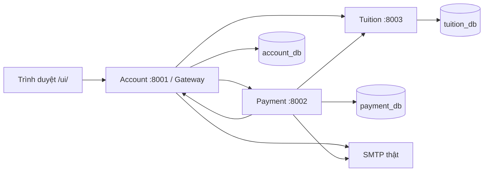

# iBanking — Thanh toán học phí

Dự án giữa kỳ môn **Kiến trúc hướng dịch vụ**, Nhóm 12. Hệ thống cho phép người dùng đăng nhập tài khoản ngân hàng, xác minh email, tra cứu học phí theo mã số sinh viên (MSSV), thanh toán bằng OTP và xem lịch sử giao dịch.

Ứng dụng gồm ba service **Account**, **Payment**, **Tuition**, sử dụng FastAPI, SQLAlchemy và SQL Server. Giao diện viết bằng HTML/CSS/JavaScript. Có thể khởi động toàn bộ ứng dụng bằng Docker từ một cửa sổ PowerShell.

## Chạy nhanh

Sau khi đã cài Docker Desktop và chuẩn bị `infra/env/docker.env` (xem [mục 2](#2-cài-đặt-và-chạy-lần-đầu)), mở PowerShell tại thư mục dự án và chạy:

```powershell
powershell -ExecutionPolicy Bypass -File .\start.ps1
```

Lệnh khởi động toàn bộ hệ thống và hiện log ngay trong terminal; nhấn **Ctrl+C** để dừng. Mở Web tại [http://127.0.0.1:8001/ui/](http://127.0.0.1:8001/ui/). Thêm `-Detached` để chạy nền, thêm `-PrepareDemo` để tạo dữ liệu demo ở lần chạy đầu.

## Mục lục

1. [Chức năng và kiến trúc](#1-chức-năng-và-kiến-trúc)
2. [Cài đặt và chạy lần đầu](#2-cài-đặt-và-chạy-lần-đầu)
3. [Khởi động lại, xem log và dừng](#3-khởi-động-lại-xem-log-và-dừng)
4. [Tài khoản và dữ liệu mẫu](#4-tài-khoản-và-dữ-liệu-mẫu)
5. [Sử dụng giao diện](#5-sử-dụng-giao-diện)
6. [Demo hai tài khoản cùng thanh toán một học phí](#6-demo-hai-tài-khoản-cùng-thanh-toán-một-học-phí)
7. [Xem và quản trị database](#7-xem-và-quản-trị-database)
8. [Kiểm thử](#8-kiểm-thử)
9. [Cấu trúc mã nguồn và tài liệu](#9-cấu-trúc-mã-nguồn-và-tài-liệu)
10. [Xử lý lỗi thường gặp](#10-xử-lý-lỗi-thường-gặp)

## 1. Chức năng và kiến trúc

- Đăng nhập, xem số dư và thông tin tài khoản được cấp.
- Cập nhật hồ sơ và xác minh email bằng mã gửi qua SMTP thật.
- Tra cứu sinh viên, học kỳ, hóa đơn và tổng công nợ theo MSSV.
- Thanh toán **toàn bộ công nợ chưa đóng của một MSSV** sau khi đồng ý điều khoản và xác minh OTP.
- Xem kết quả, lịch sử và nhận email biên nhận.
- Kiểm soát hai giao dịch cùng sử dụng số dư hoặc cùng thanh toán một nhóm hóa đơn.

| Service | Cổng | Database | Trách nhiệm |
|---|---:|---|---|
| Account | 8001 | `account_db` | Đăng nhập/JWT, hồ sơ, email, tài khoản, số dư, bút toán; phục vụ Web và gateway |
| Payment | 8002 | `payment_db` | Giao dịch, OTP, điều phối thanh toán, đối soát và gửi biên nhận |
| Tuition | 8003 | `tuition_db` | Sinh viên, hóa đơn, giữ học phí và ghi nhận đã thanh toán |



Ba database nằm trên cùng SQL Server trong bản Docker demo. Mỗi service quản lý dữ liệu của mình và trao đổi nghiệp vụ qua REST. Luồng thanh toán dùng transaction cục bộ, khóa dữ liệu và cơ chế đối soát/bù trừ; không có một transaction ACID chung cho cả ba service. Xem [kiến trúc chi tiết](docs/architecture.md).

## 2. Cài đặt và chạy lần đầu

### Yêu cầu

- Windows và PowerShell để sử dụng các script `.ps1` đi kèm.
- Docker Desktop hoạt động ở chế độ **Linux containers**.
- Internet cho lần tải image và dependency đầu tiên.
- Tài khoản SMTP thật có thông số máy chủ và quyền gửi thư.
- SQL Server Management Studio (SSMS), nếu muốn xem database trực tiếp.

Chạy bằng Docker không yêu cầu cài Python, Node.js hoặc SQL Server riêng trên Windows. Python/Node.js chỉ cần khi phát triển hoặc kiểm thử ngoài container.

### Bước 1 — Mở PowerShell tại thư mục dự án

Thư mục hiện tại phải chứa `compose.yaml`, `start.ps1`, `services/` và `frontend/`. Có thể mở terminal ngay trong VS Code tại thư mục này.

### Bước 2 — Chuẩn bị cấu hình Docker

Nếu chưa có `infra/env/docker.env`, tạo từ file mẫu:

```powershell
if (-not (Test-Path -LiteralPath .\infra\env\docker.env)) {
    Copy-Item -LiteralPath .\infra\env\docker.env.example -Destination .\infra\env\docker.env
}
```

Mở `infra/env/docker.env` và thay toàn bộ giá trị mẫu:

| Biến | Nội dung cần điền |
|---|---|
| `MSSQL_SA_PASSWORD` | Mật khẩu SQL Server cho `sa`; nên từ 16 ký tự, có chữ hoa/thường, số và ký tự đặc biệt |
| `JWT_SECRET_KEY` | Chuỗi ngẫu nhiên riêng, ít nhất 32 ký tự, dùng ký JWT |
| `INTERNAL_API_KEY` | Chuỗi ngẫu nhiên khác JWT, ít nhất 32 ký tự, dùng cho REST nội bộ |
| `SMTP_HOST`, `SMTP_PORT` | Máy chủ và cổng SMTP của nhà cung cấp |
| `SMTP_USERNAME`, `SMTP_PASSWORD` | Thông tin xác thực tài khoản gửi thư |
| `SMTP_FROM` | Địa chỉ người gửi được nhà cung cấp cho phép |
| `SMTP_STARTTLS`, `SMTP_SSL` | Chế độ bảo mật SMTP; không bật cả hai cùng lúc |

Ví dụ phần SMTP với STARTTLS, cần thay bằng thông số thật của bạn:

```dotenv
SMTP_HOST=smtp.your-provider.example
SMTP_PORT=587
SMTP_USERNAME=sender@example.com
SMTP_PASSWORD=YOUR_PROVIDER_APP_PASSWORD
SMTP_FROM=sender@example.com
SMTP_STARTTLS=true
SMTP_SSL=false
```

`infra/env/docker.env` dùng khi chạy Docker. File `.env` ở gốc dành cho chạy Python trực tiếp trên máy phát triển. Giữ cấu hình riêng đang có; không chép đè bằng file mẫu. Các file này được loại khỏi Git và bộ nộp.

**Phân biệt người gửi và người nhận:** `SMTP_USERNAME`/`SMTP_FROM` cấu hình người gửi. Email nhận mã lấy từ hồ sơ của người dùng đang đăng nhập. Ứng dụng chính chỉ dùng SMTP thật, không chạy Mailpit.

### Bước 3 — Kiểm tra và khởi động

Kiểm tra Docker và tính hợp lệ của cấu hình Compose:

```powershell
powershell -ExecutionPolicy Bypass -File .\start.ps1 -Check
```

Khởi động và tạo bộ dữ liệu demo còn thiếu:

```powershell
powershell -ExecutionPolicy Bypass -File .\start.ps1 -PrepareDemo -Detached
```

Script khởi động SQL Server, chạy `db-init` để tạo/migrate database, chờ ba API sẵn sàng rồi chuẩn bị dữ liệu mẫu. Dòng `db-init Exited (0)` là bình thường: tác vụ khởi tạo đã hoàn tất.

`-Check` kiểm tra cấu hình, chưa xác nhận SMTP đăng nhập/gửi thư được. Việc nhận mã tại hộp thư thật được kiểm tra khi người dùng xác minh hồ sơ trên Web.

### Bước 4 — Mở ứng dụng

| Thành phần | Địa chỉ |
|---|---|
| Web | [http://127.0.0.1:8001/ui/](http://127.0.0.1:8001/ui/) |
| Account Swagger | [http://127.0.0.1:8001/docs](http://127.0.0.1:8001/docs) |
| Payment Swagger | [http://127.0.0.1:8002/docs](http://127.0.0.1:8002/docs) |
| Tuition Swagger | [http://127.0.0.1:8003/docs](http://127.0.0.1:8003/docs) |
| SQL Server trong SSMS | `127.0.0.1,14330` |

Trên bộ mới tạo, có thể đăng nhập `demo05` / `Demo_123!`, cập nhật và xác minh email thật, sau đó tra `SV20261007` để thử khoản học phí 1 triệu đồng.

## 3. Khởi động lại, xem log và dừng

Các lần chạy tiếp theo, dùng:

```powershell
powershell -ExecutionPolicy Bypass -File .\start.ps1 -Detached
```

| Lệnh | Tác dụng |
|---|---|
| `start.ps1 -Detached` | Chạy nền, giữ nguyên dữ liệu hiện có |
| `start.ps1` | Chạy và theo dõi log trong terminal; Ctrl+C sẽ dừng các container của dự án |
| `start.ps1 -PrepareDemo -Detached` | Chạy nền và bổ sung bộ demo còn thiếu |
| `start.ps1 -SeedDemo -Detached` | Chạy nền và bổ sung bộ tối thiểu `huy` / `SV20261013` |
| `start.ps1 -Rebuild -Detached` | Chủ động build lại image ứng dụng rồi khởi động |
| `start.ps1 -Check` | Kiểm tra Docker/Compose, chưa chạy ứng dụng hay tạo dữ liệu |

Các lệnh ngắn trong bảng chạy với tiền tố `.\` tại gốc dự án. Nếu PowerShell chặn script, dùng cách gọi `powershell -ExecutionPolicy Bypass -File ...` như ở bước cài đặt.

Xem trạng thái, log và dừng ứng dụng chạy nền:

```powershell
docker compose --env-file infra/env/docker.env ps -a
docker compose --env-file infra/env/docker.env logs --tail 100 account payment tuition
docker compose --env-file infra/env/docker.env stop
```

Dữ liệu SQL được giữ trong named volume `sqlserver-data` của project `ibanking-demo`. Dừng hoặc khởi động lại container không xóa dữ liệu. Thay đổi SMTP trong env cần chạy lại `start.ps1 -Detached` để container nhận cấu hình mới.

## 4. Tài khoản và dữ liệu mẫu

### Các bộ tài khoản

Ứng dụng dùng tài khoản được cấp qua công cụ quản trị; không có màn hình tự đăng ký.

| Tài khoản | Mật khẩu ban đầu | Cách tạo |
|---|---|---|
| `demo01`–`demo10` | `Demo_123!` | `start.ps1 -PrepareDemo -Detached` |
| `huy` | `HuyDemo_123!` | `start.ps1 -SeedDemo -Detached` hoặc `demo-data.ps1 -Seed` |
| `huy2` | `HuyDemo_123!` | `demo-data.ps1 -CreateTestAccount -Email ...` |

Mỗi tài khoản **mới tạo** có số dư ban đầu 10 triệu đồng. Chạy lại seed/chuẩn bị giữ nguyên mật khẩu, hồ sơ, số dư và lịch sử đã có. Số dư thực tế của tài khoản đã sử dụng có thể thấp hơn 10 triệu.

Các tài khoản mới chưa được xác minh email. Tài khoản demo được tạo với email trống; tài khoản cũ còn địa chỉ mẫu cũng cần cập nhật email thật trước khi thanh toán.

### Sinh viên và học phí

`-PrepareDemo` quản lý 12 sinh viên sau:

| MSSV | Sinh viên | Học phí ban đầu |
|---|---|---:|
| `SV20261001` | Nguyễn Minh An | 2.500.000 đồng |
| `SV20261002` | Trần Ngọc Linh | 3.500.000 đồng |
| `SV20261003` | Lê Hoàng Nam | 7.000.000 đồng |
| `SV20261004` | Phạm Thu Hà | 7.000.000 đồng |
| `SV20261005` | Hoàng Gia Bảo | Hai kỳ: 2.000.000 + 3.000.000 đồng |
| `SV20261006` | Võ Khánh Vy | 1.000.000 đồng |
| `SV20261007` | Đặng Minh Quân | 1.000.000 đồng |
| `SV20261008` | Bùi Ngọc Anh | 2.000.000 đồng |
| `SV20261009` | Đỗ Đức Huy | 1.000.000 đồng |
| `SV20261010` | Hồ Thảo Nhi | 2.000.000 đồng |
| `SV20261011` | Dương Tuấn Kiệt | 1.000.000 đồng |
| `SV20261012` | Ngô Phương Thảo | 2.000.000 đồng |

Bộ này có 13 hóa đơn vì `SV20261005` có hai kỳ. Hóa đơn đã thanh toán không bị mở lại khi chuẩn bị demo lần nữa.

Database có thể chứa thêm sinh viên: `SV20261013` thuộc bộ `-SeedDemo`, còn `SV20261014` hoặc các mã khác có thể đã được bổ sung từ lần demo trước. Tất cả đều nằm trong cùng bảng `tuition_db.dbo.students`.

**Danh sách in khi chạy `-PrepareDemo` chỉ là 10 tài khoản và 12 sinh viên của bộ mẫu, không phải toàn bộ database.** Vì vậy, database có 14 sinh viên nhưng script in 12 là tình huống bình thường. Tài khoản ngân hàng và sinh viên là hai nhóm dữ liệu riêng; người trả tiền có thể thanh toán học phí cho một sinh viên khác.

Sau khi chuẩn bị, script xuất:

- `artifacts/demo-accounts.json`: tài khoản, sinh viên và công nợ thực tế của bộ mẫu tại thời điểm chạy.
- `artifacts/demo-inspect.sql`: các câu SELECT để đối chiếu bộ mẫu trong SSMS.

Định nghĩa dữ liệu nằm tại [seed tài khoản](services/account/seed.py) và [seed học phí](services/tuition/seed.py). JSON trong `artifacts` là bản xuất thông tin; dữ liệu gốc nằm trong SQL Server.

## 5. Sử dụng giao diện

### Xác minh email và cập nhật hồ sơ

1. Đăng nhập, chọn **Thông tin cá nhân → Cập nhật thông tin**.
2. Nhập họ tên, số điện thoại, email thật bạn nhận được thư và mật khẩu hiện tại.
3. Nhấn **Lưu**. Hệ thống gửi mã 6 số tới email vừa nhập và giữ hồ sơ mới ở trạng thái chờ.
4. Mở hộp thư, kiểm tra cả thư rác, nhập mã rồi chọn **Xác minh và lưu hồ sơ**.

Mọi lần lưu hồ sơ đều cần mã xác minh, kể cả khi chỉ sửa tên/điện thoại và giữ nguyên email. Hồ sơ mới chỉ được lưu sau khi xác minh thành công. Mã có hạn 5 phút; gửi lại cần chờ 60 giây và mã cũ mất hiệu lực.

### Thanh toán học phí

1. Chọn **Đóng học phí**, nhập MSSV và nhấn **Tra cứu**.
2. Kiểm tra đúng sinh viên, học kỳ, tổng công nợ và số dư khả dụng.
3. Đồng ý điều khoản, xác nhận giao dịch và nhận OTP tại email đã xác minh của người trả.
4. Nhập đúng OTP của giao dịch đó trong 5 phút, hoàn tất bước thanh toán trên Web.
5. Xem trạng thái cuối, số dư, học phí và **Lịch sử giao dịch**. Biên nhận được gửi qua email khi thanh toán thành công.

Hệ thống thanh toán toàn bộ công nợ chưa đóng của MSSV đã tra cứu. Người dùng không nhập số tiền tùy ý hoặc chia nhỏ một hóa đơn. Cần đủ số dư và email đã xác minh trước khi thanh toán.

| Trạng thái giao dịch | Cách hiểu |
|---|---|
| `PENDING_OTP`, `OTP_VERIFIED` | Đang ở bước xác minh, chưa bắt đầu xử lý tiền |
| `PROCESSING`, `PENDING_RECONCILIATION` | Đang xử lý hoặc đối soát; theo dõi cùng mã giao dịch |
| `SUCCEEDED` | Thanh toán hoàn tất |
| `FAILED` | Giao dịch không hoàn tất; xem lý do trong chi tiết |
| `REFUNDED` | Giao dịch đã được hoàn tiền |

OTP thanh toán khác mã xác minh hồ sơ. Sau khi đổi email đã xác minh, bản nháp giao dịch còn dùng email cũ cần được hủy và tạo lại. Nút **Hủy giao dịch** áp dụng cho bản nháp chưa bắt đầu xử lý; giao dịch đang xử lý cần chờ kết quả đối soát.

## 6. Demo hai tài khoản cùng thanh toán một học phí

Nếu cần tạo `huy` trên máy mới, dùng `start.ps1 -SeedDemo -Detached`. Có thể kết hợp `-SeedDemo -PrepareDemo -Detached` để chuẩn bị cả hai bộ dữ liệu trong một lần chạy.

Tạo người trả thứ hai; thay địa chỉ ví dụ bằng email thật của người dùng:

```powershell
powershell -ExecutionPolicy Bypass -File .\demo-data.ps1 -CreateTestAccount -Email 'second-user@example.com'
```

Lệnh tạo `huy2` / `HuyDemo_123!` với số tài khoản `1000000002`, số dư ban đầu 10 triệu và email chưa xác minh. Nếu tài khoản đã có, lệnh giữ nguyên dữ liệu. Người dùng tự xác minh email trên Web.

1. Mở hai phiên đăng nhập độc lập: Chrome thường + ẩn danh, hoặc Chrome + Edge.
2. Đăng nhập `huy` ở phiên A, `huy2` ở phiên B; xác minh email thật của từng tài khoản.
3. Cả hai tra cùng MSSV còn công nợ, ví dụ `SV20261001` với khoản 2,5 triệu nếu chưa thanh toán. Kiểm tra số dư hiện tại của cả hai.
4. Tạo hai giao dịch, nhận và xác minh OTP riêng tại email của từng người.
5. Bấm thanh toán gần nhau, chờ kết quả và đối chiếu database.

Kết quả mong đợi: chỉ một người thanh toán thành công và bị trừ đúng tiền; hóa đơn chỉ được ghi `PAID` một lần. Người còn lại được từ chối xử lý hoặc UI chặn khi công nợ đã thay đổi. Nếu còn bản nháp bị chặn, dùng **Hủy giao dịch** để kết thúc bản nháp đó.

Mở [SQL đối chiếu hai người trả](docs/sql/test-shared-tuition.sql) trong SSMS trước/sau ca thử. Đổi biến `@mssv` nếu dùng sinh viên khác. Bấm tay không bảo đảm request đến đúng cùng một thời điểm; xem [kịch bản và cách đọc kết quả](docs/consistency-demo.md).

## 7. Xem và quản trị database

### Kết nối SSMS

| Thuộc tính | Giá trị |
|---|---|
| Server type | Database Engine |
| Server name | `127.0.0.1,14330` |
| Authentication | SQL Server Authentication |
| Login | `sa` |
| Password | Giá trị `MSSQL_SA_PASSWORD` trong cấu hình riêng |
| Chứng chỉ | Bật Trust server certificate cho SQL Server local của bản demo |

Chọn database cần xem, mở **New Query** và nhấn **F5** để lấy dữ liệu mới. Bảng kết quả SSMS đã chạy trước đó không tự cập nhật khi người dùng thanh toán trên Web.

| Database | Bảng chính | Nội dung |
|---|---|---|
| `account_db` | `users`, `accounts` | Đăng nhập, mật khẩu đã băm, hồ sơ, số tài khoản và số dư |
| `account_db` | `account_entries`, `account_cancellations` | Bút toán trừ/hoàn và thông tin ngăn xử lý trùng sau hủy |
| `payment_db` | `payments`, `payment_items`, `email_outbox` | Lịch sử, chi tiết giao dịch và hàng đợi biên nhận |
| `tuition_db` | `students`, `tuition_invoices` | MSSV, họ tên và hóa đơn học phí |
| `tuition_db` | `tuition_reservations`, `tuition_reservation_items` | Nhóm hóa đơn đang/đã được giao dịch giữ để xử lý |

Ví dụ xem tài khoản và toàn bộ sinh viên:

```sql
SELECT u.id AS user_id, u.username, u.full_name, u.email,
       u.email_verified_at, a.id AS account_id,
       a.account_number, a.balance, a.status
FROM account_db.dbo.users AS u
JOIN account_db.dbo.accounts AS a ON a.user_id = u.id
ORDER BY u.id;

SELECT id, mssv, full_name
FROM tuition_db.dbo.students
ORDER BY id;
```

Xem hóa đơn kèm đúng sinh viên:

```sql
SELECT i.id AS invoice_id, i.student_id, s.mssv, s.full_name,
       i.semester, i.amount_due, i.status, i.version, i.paid_payment_id
FROM tuition_db.dbo.tuition_invoices AS i
JOIN tuition_db.dbo.students AS s ON s.id = i.student_id
ORDER BY i.id;
```

`user_id`, `account_id`, `student_id`, `invoice_id` là khóa liên kết nội bộ. `account_number` là số tài khoản hiển thị; `mssv` là mã nhập khi tra học phí. `version` là phiên bản bản ghi hóa đơn để phát hiện dữ liệu đã thay đổi khi xử lý đồng thời. Trạng thái hóa đơn gồm `UNPAID` (chưa đóng), `RESERVED` (đang giữ) và `PAID` (đã đóng).

Account và Tuition đã tắt bộ đệm `IDENTITY_CACHE` để hạn chế ID nhảy một dải lớn sau restart. ID vẫn có thể khuyết khi rollback/xóa dòng; không sửa khóa bằng tay vì chúng được tham chiếu trong lịch sử. Xem [dữ liệu học phí](docs/tuition-data.md) và [migration](docs/migrations.md).

### Các lệnh quản trị dữ liệu

Chạy ứng dụng bằng `start.ps1 -Detached` trước khi dùng `demo-data.ps1`.

| Lệnh | Tác dụng |
|---|---|
| `demo-data.ps1` | Xem số bản ghi trong các database |
| `demo-data.ps1 -Seed` | Bổ sung bộ tối thiểu `huy` và `SV20261013` |
| `demo-data.ps1 -CreateTestAccount -Email ...` | Tạo người trả thứ hai `huy2` |
| `demo-data.ps1 -AddTuition ...` | Thêm sinh viên/hóa đơn chưa đóng |
| `demo-data.ps1 -NormalizeAccounts` | Chuẩn hóa ID người dùng/tài khoản cùng các liên kết, có sao lưu |
| `demo-data.ps1 -NormalizeTuition` | Chuẩn hóa bộ MSSV/ID học phí cũ cùng các liên kết, có sao lưu |
| `demo-data.ps1 -Reset` | **Xóa toàn bộ dữ liệu nghiệp vụ trong cả ba database** |

Ví dụ thêm công nợ mới để thử mà vẫn giữ các giao dịch trước:

```powershell
powershell -ExecutionPolicy Bypass -File .\demo-data.ps1 -AddTuition -Mssv SV20261015 -StudentName 'Nguyễn Tuấn Anh' -Semester 2026-2027-HK1 -Amount 1000000.00
```

Nếu sinh viên chưa có, lệnh tạo sinh viên rồi thêm hóa đơn. Cặp sinh viên/học kỳ phải chưa tồn tại; lệnh không ghi đè hóa đơn đã có. Các lệnh chuẩn hóa ID dừng API, kiểm tra dữ liệu và sao lưu trước khi chuyển; người dùng đổi ID cần đăng nhập lại.

**Reset chỉ dành cho lúc chủ động muốn làm lại từ đầu.** Nó xóa tài khoản, hồ sơ, số dư, hóa đơn, lịch sử và hàng đợi email của project local. Sau reset, dùng lại tùy chọn seed phù hợp và tự xác minh email. Hướng dẫn đầy đủ: [quản trị/reset dữ liệu](docs/demo-data-reset.md).

## 8. Kiểm thử

### Unit test

Cần Python 3.13 khi chạy test trên Windows ngoài Docker:

```powershell
py -3.13 -m venv .venv
.\.venv\Scripts\python.exe -m pip install -r requirements-dev.txt
.\.venv\Scripts\python.exe -m pytest -q
```

Nếu `.venv` đã có, dùng môi trường hiện tại thay vì tạo lại. `pytest.ini` mặc định chọn `tests/unit`; cấu hình test dùng SQLite, thay thế dịch vụ/SMTP và không sử dụng database chính hay gửi thư thật.

Các nhóm test bao phủ hồ sơ/xác minh email, OTP theo người nhận, thanh toán toàn bộ, idempotency, phục hồi lỗi, migration, chuẩn hóa ID và script khởi động.

### Integration và trình duyệt

`tests/integration/`, `tests/e2e/` và `infra/docker/compose.acceptance.yaml` còn chứa bộ nghiệm thu lịch sử phụ thuộc Mailpit. Bộ này chưa được chuyển đầy đủ sang cấu hình SMTP-only hiện tại. Không dùng `npm run test:e2e` hoặc bộ load/fault cũ như một bước kiểm tra mặc định trên ứng dụng SMTP thật.

Các bài integration có thể tạo dữ liệu, dừng container hoặc ngắt mạng để thử phục hồi; cần rà soát cấu hình cô lập trước khi chạy. Kết quả nghiệm thu cũ chỉ có giá trị trong phạm vi và ngày chạy ghi trong bằng chứng. Xem [nghiệm thu và giới hạn](docs/final-acceptance.md) và [quy tắc email](docs/email-verification.md).

## 9. Cấu trúc mã nguồn và tài liệu

```text
Ibanking-System/
├── frontend/                 # Giao diện Web
├── services/
│   ├── account/              # Đăng nhập, hồ sơ, tài khoản, ledger
│   ├── payment/              # OTP, điều phối, recovery, outbox
│   └── tuition/              # Sinh viên, học phí, reservation
├── shared/                   # Cấu hình, kết nối DB, auth, khóa, SMTP, logging
├── infra/
│   ├── docker/               # Dockerfile, khởi tạo DB, seed/admin
│   ├── env/                  # Cấu hình mẫu và cấu hình Docker riêng
│   └── sql/                  # SQL khởi tạo và SELECT kiểm tra
├── tests/                    # Unit và các bộ integration/E2E
├── docs/                     # Kiến trúc, API, hướng dẫn và nguồn báo cáo
├── scripts/                  # Xuất OpenAPI, dựng báo cáo, đóng gói
├── artifacts/                # Danh sách demo, báo cáo chạy thử, backup khi phát sinh
├── compose.yaml              # Dịch vụ và volume Docker
├── start.ps1                 # Khởi động; -PrepareDemo để bổ sung dữ liệu mẫu
├── demo-data.ps1             # Quản trị dữ liệu local
└── requirements*.txt         # Dependency ứng dụng/test/báo cáo
```

Trong `artifacts/`, giữ bản sao database và các bằng chứng còn cần dùng. File tạm từ test/render có thể dọn riêng; xóa cả thư mục sẽ làm mất các bản xuất và bằng chứng trên máy, dù dữ liệu SQL đang chạy được lưu ở Docker volume.

| Nhu cầu | Tài liệu |
|---|---|
| Kiến trúc, Use Case và ERD | [architecture.md](docs/architecture.md) |
| REST API và schema công khai | [api.md](docs/api.md), [OpenAPI](docs/api/) |
| Cấu hình, vận hành và debug | [runbook.md](docs/runbook.md) |
| Email, OTP và hồ sơ | [email-verification.md](docs/email-verification.md) |
| Kịch bản trình bày | [demo-script.md](docs/demo-script.md) |
| Hai phiên cùng thanh toán | [consistency-demo.md](docs/consistency-demo.md) |
| Sinh viên, hóa đơn và ID | [tuition-data.md](docs/tuition-data.md), [SQL xem học phí](infra/sql/004_inspect_tuition.sql) |
| Đổi schema và dữ liệu cũ | [migrations.md](docs/migrations.md) |
| Truy vết và log | [observability.md](docs/observability.md) |
| Nguồn báo cáo và thông tin nhóm | [final-report-detailed.md](docs/final-report-detailed.md), [team.json](docs/team.json) |
| Chuẩn bị bài nộp | [pre-submit.md](docs/pre-submit.md), [submission-filter.md](docs/submission-filter.md) |

Việc xuất báo cáo/đóng gói là bước riêng, không cần để mở ứng dụng. Công cụ hiện dùng là `scripts/build_detailed_report.py` và `scripts/package_clean_submission.py`. Cần có đủ ảnh, JSON bằng chứng và báo cáo/slide đầu vào theo [chính sách bộ nộp](docs/submission-filter.md); các đầu vào này không tự được tạo khi khởi động ứng dụng.

## 10. Xử lý lỗi thường gặp

| Hiện tượng | Cách kiểm tra/xử lý |
|---|---|
| PowerShell chặn chạy `.ps1` | Gọi script bằng `powershell -ExecutionPolicy Bypass -File ...` |
| Compose báo thiếu biến hoặc còn `CHANGE_ME` | Điền `infra/env/docker.env`, gồm cả SMTP thật; chạy lại `start.ps1 -Check` |
| Web/SSMS không kết nối | Chạy `start.ps1 -Detached`, kiểm tra trạng thái container bằng lệnh ở mục 3; SSMS dùng đúng `127.0.0.1,14330` |
| Docker build lỗi tải image/DNS | Kiểm tra Docker Desktop và Internet; xem log rồi chạy lại. Không cần reset database để sửa lỗi mạng |
| Đóng terminal thì ứng dụng dừng | Dùng `-Detached` để chạy nền |
| Không nhận mã email | Kiểm tra địa chỉ đang hiển thị, thư rác, SMTP host/cổng/TLS và thông tin xác thực; xem log Account/Payment |
| Đổi email nhưng OTP giao dịch vẫn dùng email cũ | Hoàn tất xác minh hồ sơ, hủy bản nháp cũ và tạo giao dịch mới |
| UI đã đóng học phí nhưng SSMS vẫn hiện `UNPAID` | Chạy lại SELECT bằng F5, đối chiếu đúng MSSV và `invoice_id`, kiểm tra đúng SQL Server/database |
| `-PrepareDemo` in 12 sinh viên nhưng database có nhiều hơn | Script chỉ in bộ mẫu được quản lý; dùng SELECT toàn bộ `students` để xem các sinh viên bổ sung |
| Chạy seed lại nhưng số dư/học phí không trở về ban đầu | Đây là hành vi giữ dữ liệu; thêm hóa đơn mới hoặc dùng quy trình reset khi muốn xóa toàn bộ |
| Đổi mật khẩu `sa` trong env nhưng SQL vẫn từ chối | SQL volume cũ giữ mật khẩu đã thiết lập; sửa env không tự đổi mật khẩu login trong SQL Server |

Khi giao dịch đang đối soát, theo dõi mã giao dịch hiện có và kết quả cuối. Không tự đổi trạng thái hóa đơn, sửa số dư hay xóa bút toán để làm mới một ca demo.
