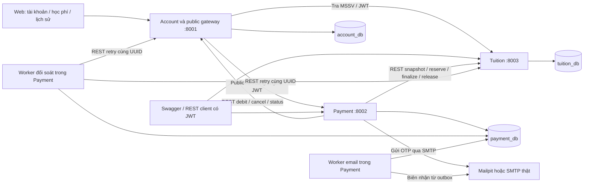
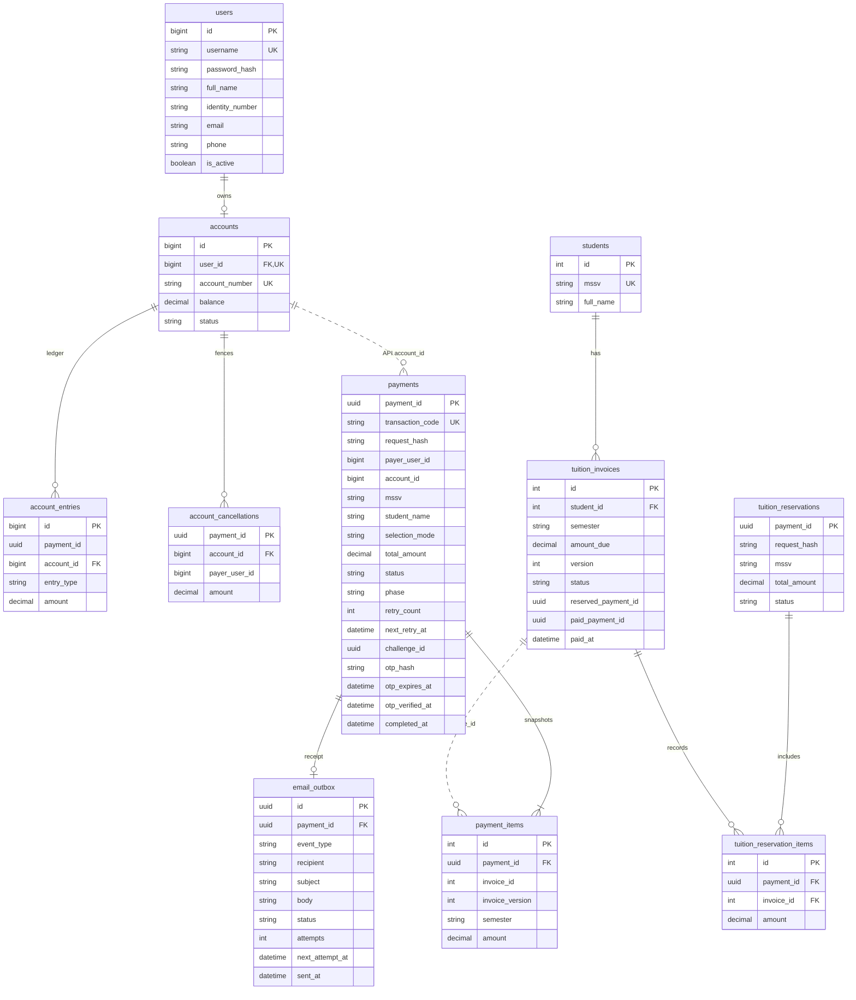
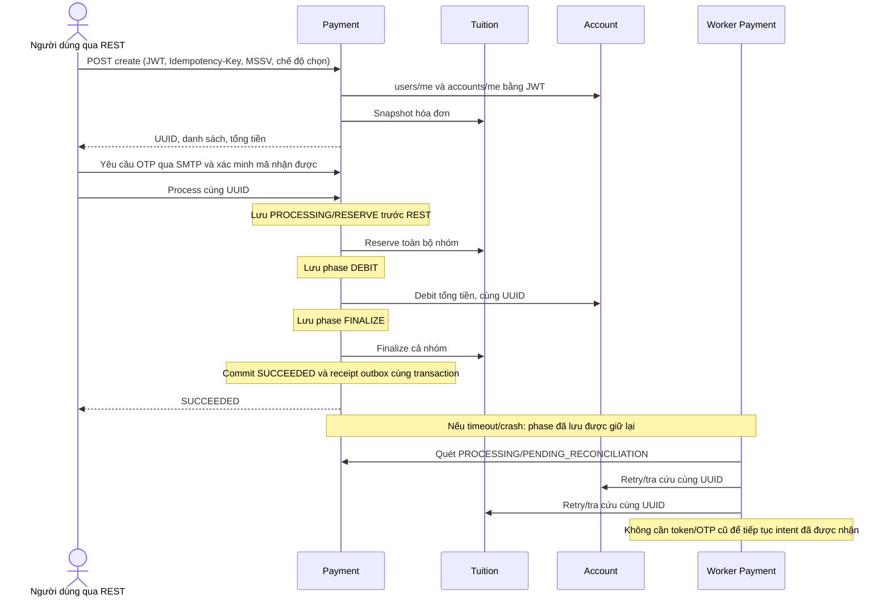

# Kiến trúc và phân tích nghiệp vụ — mốc hoàn thành 08/11

Cập nhật ngày 02/11/2026: đã hoàn thành sớm phần việc 02–08/11, gồm backend,
SMTP/outbox, UI, tải và lỗi hạ tầng. Sơ đồ mô tả mã đã chạy và kiểm thử;
bản hình xuất ở `docs/diagrams/exported`, nguồn có thể sửa nằm trong PPTX bàn giao.

## Microservices

| Service | Quyền sở hữu và trách nhiệm |
|---|---|
| Account | Người dùng, JWT, tài khoản, số dư, ledger, dấu hủy debit |
| Tuition | Sinh viên/MSSV, hóa đơn, phiên bản, nhóm reservation và dấu hủy |
| Payment | UUID, PaymentItem, OTP, phase/retry, lịch sử, outbox biên nhận |

Mỗi service có engine, session, metadata và database riêng. Payment chỉ gọi REST;
không import model/đọc bảng Account hoặc Tuition. Tham chiếu user/account/invoice
trong Payment là ID logic, không là FK xuyên database. Các bảng prototype cũ
được giữ trong DB, không được API mới dùng. `shared/` chỉ chia sẻ hạ tầng kỹ thuật.

Docker dùng một SQL Server chứa ba DB cho demo. Chưa tách SQL login theo DB;
Account có gateway chỉ cho public API, UI dùng cùng origin không cần mở CORS.
Hai worker thanh toán/email khởi động cùng Payment, nên `start.ps1` vẫn là một lệnh.

Guard session applock dùng engine NullPool riêng, không lấy kết nối từ pool ORM
trong lúc chờ HTTP/SMTP. Bản thử tải ban đầu đã phát hiện nguy cơ hết pool khi
nhiều guard giữ kết nối và transaction ngắn không còn kết nối để hoàn tất.

## Use Case và quy tắc nghiệp vụ

Nguồn UML chuẩn: [use-cases.puml](diagrams/use-cases.puml).
Người trả là chủ tài khoản đã đăng nhập; sinh viên theo MSSV có thể là người khác.
Chức năng ghi/sửa hồ sơ và tài khoản nằm ngoài phân hệ học phí.

| Use Case | Điều kiện và luồng chính | Kết quả / luồng lỗi |
|---|---|---|
| UC01 Đăng nhập | Username/password hợp lệ, người dùng active | JWT có subject, issuer, audience và hạn; sai thông tin trả 401/403 |
| UC02 Tra MSSV | JWT hợp lệ; đọc tên sinh viên, các kỳ, tiền và trạng thái | Không có MSSV trả 404; RESERVED hiển thị đang xử lý |
| UC03 Chọn học phí | Chọn một/nhiều hóa đơn hoặc ALL_UNPAID | Server chốt hóa đơn/phiên bản/tổng; không nhận tiền hay người trả do client cung cấp |
| UC04 Xác minh OTP | Xác nhận snapshot rồi yêu cầu challenge | SMTP gửi mã một lần, 5 phút, 5 lần sai; resend hủy mã/xác minh cũ |
| UC05 Thanh toán | Đúng chủ, OTP còn hạn, chưa xử lý | Giữ toàn bộ nhóm → debit đúng tổng → hoàn tất; không được trả một phần nhóm |
| UC06 Tra kết quả/lịch sử | JWT và đúng chủ | Trả UUID/status/phase/items; timeout hướng dẫn tra cứu mã cũ |
| UC07 Đăng xuất | Phiên trình duyệt đang mở | UI xóa JWT trong RAM; chưa thu hồi JWT trung tâm |

Tiền dùng Decimal/NUMERIC(18,2). Mỗi sinh viên hiện có một hóa đơn cho mỗi học kỳ,
ràng buộc UNIQUE(student_id, semester). Một giao dịch có 1–100 hóa đơn. ALL_UNPAID
chốt công nợ có thể trả tại thời điểm tạo, không tự bổ sung hóa đơn được phát hành sau đó.

## ERD đã triển khai

Các quan hệ có ghi API là tham chiếu logic, không phải khóa ngoại giữa DB.
`schema_revisions` là bảng hạ tầng riêng trong mỗi DB, lược khỏi sơ đồ nghiệp vụ.

UUID được lưu dưới String(36). Ledger có UNIQUE(payment_id, entry_type);
PaymentItem và ReservationItem có UNIQUE(payment_id, invoice_id).
Balance không âm, các khoản thanh toán/bút toán dương. Reservation RELEASED có
thể không có item khi việc hủy đến trước yêu cầu giữ hóa đơn.

## Sequence thanh toán và phục hồi

Payment có session application lock theo UUID để chỉ một coordinator xử lý cùng
lúc, kể cả khi chạy nhiều instance. Khóa session tồn tại qua các transaction ngắn;
không giữ transaction SQL mở trong khi gọi REST. DB session mất thì SQL Server
nhả khóa, worker khác tiếp tục từ trạng thái đã commit.

Tuition dùng transaction application lock theo UUID và UPDLOCK/HOLDLOCK trên từng
invoice theo ID tăng dần; nhóm giao nhau không bị giữ/hoàn tất một phần.
Account khóa UUID trước và khóa dòng tài khoản khi sửa balance, ghi ledger trong
cùng transaction. Tham khảo [Microsoft sp_getapplock](https://learn.microsoft.com/en-us/sql/relational-databases/system-stored-procedures/sp-getapplock-transact-sql)
và [table hints](https://learn.microsoft.com/en-us/sql/t-sql/queries/hints-transact-sql-table).

Hủy/bù trừ: fence Tuition trước. Nếu nhóm đã PAID, kiểm tra DEBITED và kết thúc
SUCCEEDED; không refund nhóm đã trả. Nếu RELEASED, Account cancel hoàn khoản đã
trừ hoặc lưu dấu hủy để debit đến muộn không có hiệu lực. Chỉ khi hoàn tất bù trừ
mới kết thúc FAILED/REFUNDED. Không tự nhả hóa đơn đang xử lý chỉ vì hết thời gian.

## Email và giao diện

Worker email đọc outbox và gửi SMTP ngoài transaction, retry không gọi lại thanh
toán. Message-ID cố định, một sự kiện/payment; SMTP có thể gửi trùng khi mất ACK.
UI tra MSSV, chọn hóa đơn, OTP, kết quả và lịch sử qua gateway Account. Chỉ UUID/
user ID được lưu tạm để phục hồi; token và OTP nằm trong bộ nhớ. Xem
[bàn giao UI/email](ui-email-delivery.md).
