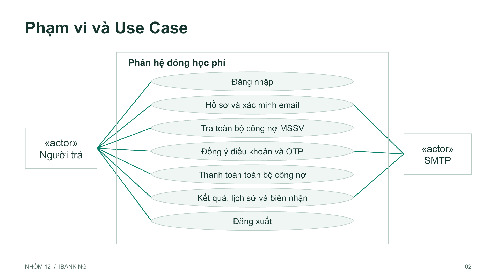
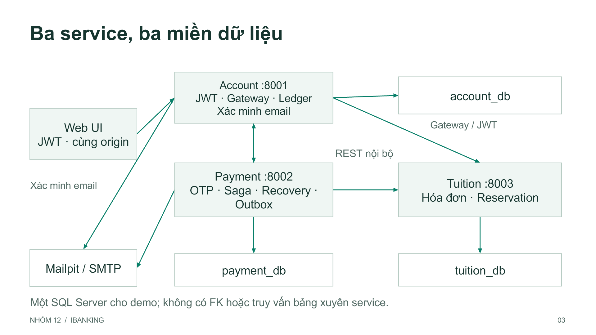
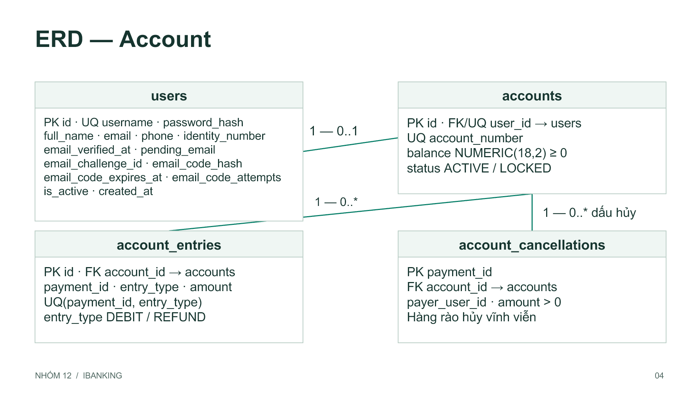
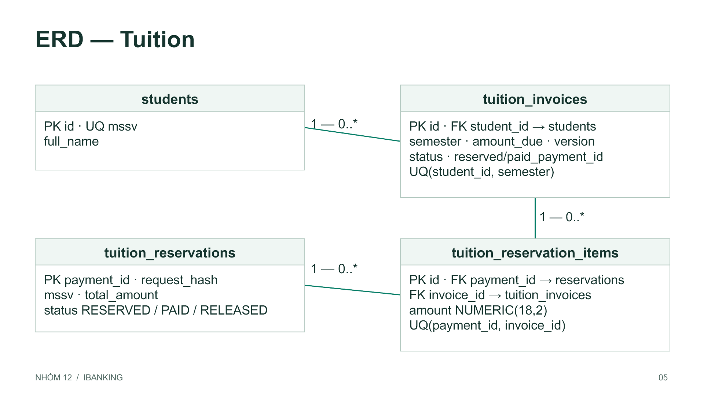
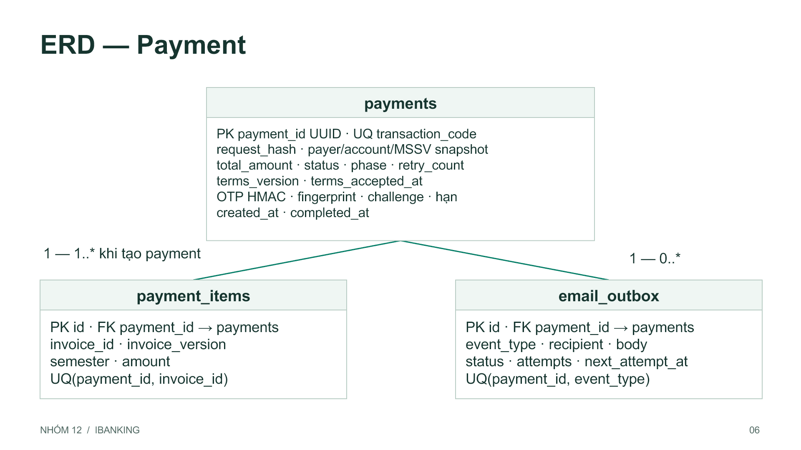
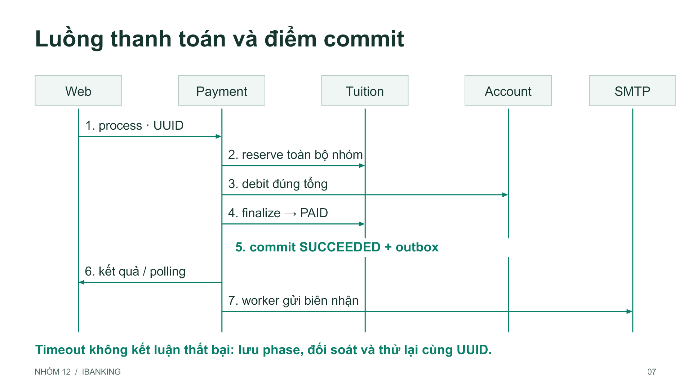

# Phân hệ đóng học phí qua ứng dụng iBanking

## Tóm tắt

Phân hệ hỗ trợ người dùng dùng số dư tài khoản iBanking để thanh toán toàn bộ công nợ học phí của một sinh viên theo MSSV. Người trả có thể đóng cho chính mình hoặc sinh viên khác. Hệ thống lấy hồ sơ người trả từ tài khoản đang đăng nhập, kiểm tra công nợ và số dư, gửi OTP qua email, thực hiện thanh toán, lưu lịch sử và gửi biên nhận. Phạm vi không yêu cầu đăng ký tài khoản công khai.

Sản phẩm gồm ba dịch vụ FastAPI: Account, Tuition và Payment, với ba database SQL Server riêng. Payment điều phối các thao tác REST; từng dịch vụ bảo vệ dữ liệu bằng transaction cục bộ, khóa và ràng buộc. Trạng thái điều phối được lưu bền vững để phục hồi khi mất phản hồi hoặc service khởi động lại. Gateway tại Account phục vụ Web cùng origin; Docker Compose cho phép chạy toàn bộ hệ thống bằng một lệnh.

Báo cáo trình bày yêu cầu, use case, kiến trúc, từ điển dữ liệu, hợp đồng API, xác minh email, OTP tài chính và cơ chế nhất quán. Hai tình huống bắt buộc được phân tích bằng lịch thực thi xen kẽ: nhiều giao dịch trên cùng tài khoản và nhiều người cùng trả một khoản học phí. Bằng chứng nghiệm thu gắn với lượt `{{RUN}}`, bao gồm {{UNIT}} unit test, {{BROWSER}} bài giao diện và các kịch bản SQL/SMTP/sự cố trên môi trường riêng.

### Thuật ngữ sử dụng

| Thuật ngữ | Ý nghĩa trong báo cáo |
|---|---|
| MSSV | Mã số sinh viên dùng tra cứu học phí; độc lập với chủ tài khoản trả tiền. |
| OTP | Mã dùng một lần để xác thực một giao dịch thanh toán cụ thể. |
| Snapshot | Danh sách hóa đơn, phiên bản và tổng tiền được chốt lúc người dùng xác nhận. |
| Idempotency | Yêu cầu lặp cùng định danh không làm lặp hiệu lực trừ tiền hoặc thanh toán. |
| Saga / compensation | Chuỗi transaction cục bộ và thao tác bù trừ khi một bước không thể hoàn tất. |
| Outbox / correlation ID | Sự kiện email bền vững / mã nối các log cùng một request qua nhiều service. |

---

<!-- TOC -->

---

## 1. Phân tích đề bài và phạm vi sản phẩm

Mục tiêu nghiệp vụ là kết thúc một khoản đóng học phí với ba kết quả thống nhất: tài khoản bị trừ đúng tiền, học phí chuyển sang đã thanh toán và lịch sử ghi nhận đúng giao dịch. Các bước gửi OTP, nhận kết quả và gửi biên nhận phải gắn với cùng người trả và cùng bộ học phí đã xác nhận.

### Yêu cầu chức năng

| Mã | Yêu cầu | Kết quả cần quan sát |
|---|---|---|
| FR01 | Đăng nhập bằng username/password | Tài khoản hợp lệ truy cập được chức năng đóng học phí. |
| FR02 | Quản lý hồ sơ, số dư và lịch sử | Có họ tên, điện thoại, email, số dư khả dụng và giao dịch đúng chủ. |
| FR03 | Tự tra cứu sau khi nhập MSSV | Hiện tên sinh viên, hóa đơn và tổng công nợ. |
| FR04 | Thanh toán toàn bộ | Giao dịch bao gồm đầy đủ các hóa đơn chưa đóng; không trả một phần. |
| FR05 | Kiểm tra điều kiện xác nhận | Đủ hồ sơ, công nợ hợp lệ, số dư đủ và đồng ý điều khoản. |
| FR06 | OTP qua email | Mã gắn giao dịch, không trùng mã còn hiệu lực, tối đa 5 phút và dùng một lần. |
| FR07 | Xử lý kết quả thành công | Debit, PAID, lịch sử và biên nhận phản ánh cùng kết quả. |
| FR08 | Chống giao dịch cạnh tranh | Không chi vượt số dư và không trả trùng khoản học phí. |

### Các yêu cầu kỹ thuật

Sản phẩm cần Use Case Diagram, ERD, sơ đồ kiến trúc Microservices, REST API với request/response và HTTP status, cơ sở dữ liệu lưu bền vững, Web tích hợp API cùng tài liệu cài đặt/trình diễn. Báo cáo ánh xạ các yêu cầu này tới mã nguồn và bằng chứng ở chương 26.

Xác minh quyền sở hữu email được bổ sung theo yêu cầu sử dụng thực tế: địa chỉ mới chỉ có hiệu lực khi người dùng nhập đúng mã nhận tại địa chỉ đó. Đây là bước hồ sơ, tách biệt với OTP tài chính. Dữ liệu sinh viên/học phí được mô phỏng trong SQL Server; sản phẩm không tích hợp hệ thống thu học phí thật của trường trong phạm vi này.

> Nguồn: đề bài và phiếu chấm môn học do nhóm cung cấp; docs/api.md; services/payment/policy.py.

---

## 2. Actor và quy tắc nghiệp vụ

Actor chính là chủ tài khoản iBanking đã được cấp quyền. Sinh viên theo MSSV là đối tượng có công nợ và có thể khác người trả. SMTP là dịch vụ ngoài để chuyển mã xác minh hồ sơ, OTP thanh toán và biên nhận; nó không quyết định một khoản học phí đã được thanh toán hay chưa.

| Mã | Quy tắc | Nơi thực thi chính |
|---|---|---|
| BR01 | Danh tính người trả lấy từ JWT; không nhận payer/account tùy ý từ client | Payment create và Account ownership. |
| BR02 | Người trả chỉ đọc trên màn thanh toán | Web hiển thị từ hồ sơ; thay đổi ở trang hồ sơ riêng. |
| BR03 | Chỉ `ALL_UNPAID`; đồng ý điều khoản phải là boolean true | PaymentCreate dùng Literal/StrictBool và cấm trường dư. |
| BR04 | Số dư khả dụng lớn hơn hoặc bằng tổng công nợ | Kiểm tra ở UI/create và kiểm tra lại dưới khóa Account khi debit. |
| BR05 | Không có khoản PAID/RESERVED bị trả lại trong nhóm mới | Snapshot và reserve tại Tuition. |
| BR06 | Công nợ thay đổi sau xác nhận thì phải tra cứu/xác nhận lại | So tập hóa đơn UNPAID, version và tổng khi reserve. |
| BR07 | Email đã xác minh phải khớp email snapshot của giao dịch | Kiểm tra trước gửi/xác minh OTP và trước lần process đầu. |
| BR08 | Chỉ kết thúc thành công khi debit và nhóm PAID được xác nhận | Coordinator và audit ba database. |

### Tiền và giới hạn dữ liệu

Tiền dùng Decimal ở Python và NUMERIC(18,2) trong SQL Server, tránh tính tổng bằng số thực nhị phân. API biểu diễn tiền bằng chuỗi thập phân. Một giao dịch hiện chốt từ 1 đến 100 hóa đơn; tổng tiền phải dương và nằm trong miền lưu trữ. Mỗi sinh viên có tối đa một hóa đơn cho mỗi giá trị semester theo UNIQUE(student_id, semester).

Tại thời điểm tạo, snapshot chỉ gồm công nợ đang có. Nếu một hóa đơn mới xuất hiện trước lúc giữ nhóm, server không tự bổ sung âm thầm vào số tiền đã xác nhận; thay vào đó từ chối để người dùng kiểm tra lại. Quy tắc này bảo vệ sự đồng ý của người trả và vẫn bảo đảm thanh toán toàn bộ công nợ hợp lệ.

> Nguồn: services/payment/schemas.py, routes.py; services/tuition/internal_routes.py; frontend/payments.js.

---

## 3. Use Case Diagram và danh mục chức năng



| Use case | Mục đích | Actor / điều kiện |
|---|---|---|
| UC01 / UC07 | Đăng nhập / đăng xuất | Người dùng; username/password / phiên hiện tại. |
| UC02 | Tra sinh viên và công nợ | Người dùng đã đăng nhập, MSSV hợp lệ. |
| UC03 | Xác nhận toàn bộ công nợ và điều khoản | Đủ hồ sơ, đủ tiền, không có khoản đang xử lý. |
| UC04 / UC05 | Xác minh OTP / thực hiện thanh toán | Đúng chủ, đúng challenge, mã còn hiệu lực. |
| UC06 | Xem kết quả, lịch sử và biên nhận | Chỉ giao dịch thuộc người đang đăng nhập. |
| UC08 / UC09 | Cập nhật hồ sơ / xác minh email | JWT, mật khẩu hiện tại; email đổi hoặc chưa xác minh. |

Sơ đồ hình là bản tổng quan. Nguồn PlantUML `docs/diagrams/use-cases.puml` trình bày các quan hệ include/extend chi tiết. Xác minh email mở rộng việc cập nhật hồ sơ khi địa chỉ thay đổi hoặc chưa được xác minh; không phải mọi lần sửa điện thoại đều phải gửi lại mã email.

---

## 4. Đặc tả luồng đăng nhập và hồ sơ

### UC01 Đăng nhập

Tiền điều kiện là tài khoản đã được cấp và còn hoạt động. Người dùng nhập username/password; server chuẩn hóa username bằng trim và chuyển về chữ thường, giữ nguyên mật khẩu để kiểm tra hash. Sai username hoặc password cùng nhận thông báo lỗi chung; tài khoản bị vô hiệu hóa được từ chối. Thành công trả JWT có sub, iat, exp, iss và aud.

Hậu điều kiện là trình duyệt nạp đủ hồ sơ và tài khoản trước khi hiện không gian cá nhân. Nếu chỉ lấy được token nhưng một API hồ sơ/số dư thất bại, giao diện xóa token tạm và giữ màn đăng nhập, tránh hiển thị tài khoản chưa được nạp đầy đủ. Token chỉ ở RAM; đăng xuất xóa phiên và dữ liệu cá nhân trên UI.

### UC08 và UC09 Cập nhật thông tin

| Bước | Xử lý | Hậu điều kiện |
|---|---|---|
| 1 | Kiểm tra JWT, active và mật khẩu hiện tại | Người không đúng chủ không thay hồ sơ được. |
| 2 | Validate họ tên, email, điện thoại, CCCD | Sai dữ liệu trả 422; không lưu một phần. |
| 3a | Giữ nguyên email đã xác minh | Lưu thay đổi khác; trả 200. |
| 3b | Đổi email hoặc email chưa xác minh | Lưu draft và challenge, gửi mã đến địa chỉ đích; trả 202. |
| 4 | Người dùng nhập challenge/code đúng | Ghi hồ sơ, email và dấu xác minh trong cùng transaction. |
| 5 | Mã sai/hết hạn, hủy hoặc gửi thất bại | Hồ sơ đang dùng giữ nguyên; có thể gửi lại theo cooldown. |

Email chờ được hiển thị cùng ô nhập mã ngay ở phần hồ sơ. Khi mất phản hồi sau thao tác Lưu, giao diện đọc lại trạng thái chờ để tiếp tục xác minh. Điều này xử lý trường hợp email đã được gửi nhưng người dùng chưa nhìn thấy bước nhập mã.

> Nguồn: services/account/routes.py, security.py, email_verification.py; frontend/account-forms.js; tests/e2e/email-verification.spec.cjs.

---

## 5. Đặc tả luồng tra cứu và thanh toán

Tra cứu MSSV yêu cầu người dùng đã đăng nhập bằng JWT hợp lệ. Để xác nhận thanh toán còn cần người dùng active, tài khoản ACTIVE, hồ sơ hợp lệ và email đã xác minh. Người dùng nhập MSSV; UI tự tra cứu sau khoảng chờ ngắn, đồng thời làm mới số dư. Mỗi kết quả tra cứu gắn với giá trị MSSV hiện tại, nên phản hồi đến muộn không thể thay tên/tổng tiền của một MSSV vừa nhập khác.


### Luồng chính và kết quả

- Hệ thống hiển thị người trả chỉ đọc, sinh viên, toàn bộ hóa đơn chưa đóng, tổng tiền và số dư khả dụng.
- Người dùng đọc điều khoản, tích đồng ý và xác nhận. Client sinh UUID cho Idempotency-Key, gửi MSSV và `ALL_UNPAID`.
- Server chốt snapshot, UI yêu cầu gửi OTP và hiển thị bước nhập mã. Mã được gửi tới email đã xác minh của người trả.
- Sau verify-otp thành công, UI gọi process; server kiểm tra lại rồi thực hiện reserve, debit và finalize.
- UI hiện SUCCEEDED, làm mới số dư và hiển thị snapshot đã thanh toán; người dùng mở lịch sử hoặc tra lại công nợ để đối chiếu. Nếu chưa rõ kết quả, UI giữ UUID và tra cứu tiếp.

Nhánh thay thế gồm không tìm thấy MSSV, công nợ bằng không, số dư thiếu, hồ sơ thiếu, tài khoản khóa, công nợ đang RESERVED, OTP sai/hết hạn và upstream timeout. Trong các trường hợp chưa đủ điều kiện, nút Xác nhận bị khóa; backend vẫn kiểm tra lại để không phụ thuộc việc client có sửa giao diện hay không.

---

## 6. Kiến trúc Microservices



| Thành phần | Dữ liệu sở hữu | Trách nhiệm |
|---|---|---|
| Account | users, accounts, account_entries, account_cancellations | Đăng nhập/JWT, email proof, hồ sơ, số dư, debit/refund và gateway Web. |
| Tuition | students, tuition_invoices, reservations và items | Tra MSSV, kiểm tra toàn bộ công nợ, giữ/hoàn tất/nhả nhóm nguyên tử. |
| Payment | payments, payment_items, email_outbox | Snapshot, OTP, trạng thái/phase, REST orchestration, recovery, lịch sử và biên nhận. |

Mỗi service có engine, session, metadata và migration riêng. Trong luồng nghiệp vụ, Payment không import model hoặc đọc bảng của Account/Tuition; nó gọi REST để nhận kết quả. Tham chiếu user/account/invoice trong Payment là ID logic, không phải khóa ngoại xuyên database. Các script quản trị và nghiệm thu có thể đọc trực tiếp nhiều DB để chuẩn bị dữ liệu và kiểm toán.

Demo dùng chung một SQL Server và cùng image ứng dụng nhưng chạy ba process/container với ba database độc lập. Login SQL hiện dùng chung cho demo; ownership là ranh giới logic trong mã nguồn, chưa phải mô hình cách ly quyền DB đầy đủ. Thư mục shared chỉ chia sẻ hạ tầng kỹ thuật, không chia sẻ model nghiệp vụ.

---

## 7. Quyết định thiết kế và giao tiếp

### Vì sao phân rã theo Account, Tuition và Payment

Account bảo vệ tiền và bút toán, Tuition bảo vệ trạng thái học phí, Payment quản lý ý định và tiến trình giao dịch. Phân rã này đặt mỗi bất biến cục bộ gần dữ liệu chịu trách nhiệm: kiểm tra số dư cùng debit/ledger ở Account; kiểm tra và cập nhật cả nhóm hóa đơn ở Tuition. Payment không cần điều khiển SQL transaction của service khác.

### REST, gateway và SMTP

| Luồng | Cơ chế | Thông tin xác thực |
|---|---|---|
| Web → Account / gateway | HTTP cùng origin | JWT người dùng cho API được bảo vệ. |
| Gateway → Payment/Tuition | Chuyển tiếp public API được cho phép | JWT, Idempotency-Key nếu có, X-Request-ID. |
| Payment → Account đọc người trả | REST /users/me, /accounts/me | JWT của người đang xác nhận. |
| Payment → thao tác tiền/hóa đơn | REST /internal/... | X-Internal-Key từ cấu hình server. |
| Account/Payment → SMTP | smtplib, timeout và TLS tùy cấu hình | Thông tin SMTP chỉ ở cấu hình riêng. |

Gateway không chuyển internal key do trình duyệt gửi lên. Client không thể dùng gateway như proxy tùy ý vì chỉ các tuyến đã khai báo được nhận. Payment cấu hình timeout kết nối/read/write/pool; đây không phải deadline tổng wall-clock. Lỗi không xác định sau một thao tác có hiệu lực được đưa vào đối soát thay vì tự kết luận thất bại.

Worker recovery và worker mail chạy cùng tiến trình Payment, khởi động qua lifespan. Cách này giữ vận hành một lệnh trong phạm vi bài giữa kỳ. Khi mở rộng tải, có thể tách worker và quản trị secret/quyền DB mà vẫn giữ hợp đồng idempotent hiện tại.

> Nguồn: services/account/gateway.py; services/payment/clients.py, main.py; compose.yaml; shared/mailer.py.

---

## 8. Thiết kế dữ liệu Account



| Bảng | Khóa và quan hệ | Bất biến quan trọng |
|---|---|---|
| users | PK id; username unique | Mật khẩu lưu hash; hồ sơ và trạng thái email được quản lý đúng chủ. |
| accounts | PK id; FK/unique user_id; account_number unique | Tối đa một tài khoản trên một user; balance ≥ 0; status ACTIVE/LOCKED. |
| account_entries | FK account_id; unique(payment_id, entry_type) | Amount > 0; một DEBIT và tối đa một REFUND cho mỗi payment. |
| account_cancellations | PK payment_id; FK account_id | Dấu hủy bền vững để debit đến muộn không phát sinh hiệu lực. |

Số dư và ledger được cập nhật trong cùng transaction. Không dùng ledger để hiển thị lại nhiều lần trừ tiền chỉ vì request HTTP lặp. Refund luôn hoàn đúng amount của debit gốc và không tự chọn số tiền mới từ client. Account vẫn cho nhận tiền hoàn khi tài khoản LOCKED, vì đây là bù trừ khoản đã trừ.

Khóa ngoại chỉ nối các bảng cùng account_db. Các mã payment trong ledger và cancellation là tham chiếu logic tới Payment. Cấu trúc này cho phép kiểm toán một giao dịch bằng UUID trong khi giữ ownership database của từng service.

> Schema đầy đủ: services/account/models.py. Mỗi DB còn có schema_revisions để quản lý migration, được lược khỏi ERD nghiệp vụ.

---

## 9. Từ điển dữ liệu hồ sơ và xác minh email

| Trường / nhóm trường | Kiểu lưu trữ | Có thể rỗng | Ý nghĩa |
|---|---|---|---|
| id / username | BIGINT / VARCHAR(50) | Không | Khóa người dùng / tên đăng nhập duy nhất. |
| password_hash | VARCHAR(255) | Không | Hash mật khẩu; không trả qua UserResponse. |
| full_name / email | NVARCHAR(100) / VARCHAR(255) | Không | Hồ sơ đang có hiệu lực. |
| phone / identity_number | VARCHAR(20) | Có | Điện thoại/giấy tờ; kiểm tra định dạng khi cập nhật. |
| is_active / created_at | BIT / DATETIME | Không | Cờ đăng nhập và thời điểm tạo. |
| email_verified_at | DATETIME | Có | Có giá trị khi email hiện tại đã được chứng minh quyền sở hữu. |
| pending_email | VARCHAR(255) | Có | Email đích của yêu cầu đang chờ. |
| email_challenge_id / email_code_hash | VARCHAR(36) / VARCHAR(64) | Có | Định danh và HMAC mã xác minh; không lưu mã rõ. |
| email_code_expires_at / email_code_sent_at | DATETIME | Có | Hạn mã và thời điểm gửi để kiểm tra cooldown. |
| email_code_attempts | INTEGER | Không | Bộ đếm lần sai của challenge. |
| email_pending_profile | NVARCHAR(2000) | Có | JSON draft của hồ sơ cần lưu sau khi xác minh thành công. |

UserResponse chỉ trả thông tin được phép hiển thị, cờ email_verified và metadata challenge; không trả hash, draft bí mật hoặc mã xác minh. Nếu email mới chưa được chứng minh, các trường đang có hiệu lực vẫn là dữ liệu dùng cho thanh toán. Một địa chỉ đúng cú pháp hoặc được SMTP chấp nhận chưa đủ để đánh dấu đã xác minh.

Migration email proof thêm cột theo revision và giữ dữ liệu hiện có. Các email cũ không tự được coi là đã xác minh. Khi kích hoạt hồ sơ mới, cùng transaction áp dụng nội dung draft vào hồ sơ, đặt email_verified_at rồi xóa draft/challenge, tránh trường hợp thay email nhưng chưa hoàn tất bằng chứng.

> Nguồn: services/account/models.py, schemas.py, migrate.py, email_verification.py.

---

## 10. Thiết kế dữ liệu Tuition



| Bảng / trường chính | Vai trò | Ràng buộc và cách sử dụng |
|---|---|---|
| students: id, mssv, full_name | Danh mục sinh viên | PK id, MSSV unique; tên dùng hiển thị sau tra cứu. |
| tuition_invoices: student_id, semester, amount_due | Một khoản học phí theo kỳ | FK student; unique(student_id, semester); amount > 0. |
| status / version | Trạng thái và phiên bản hóa đơn | Status UNPAID/RESERVED/PAID; version kiểm tra snapshot. |
| reserved_payment_id / reserved_until | UUID giữ / cột hạn dự phòng | Luồng hiện tại không cấp TTL; phục hồi dựa trạng thái và phase, không tự nhả nhóm theo giờ. |
| paid_payment_id / paid_at | Giao dịch và thời điểm đã trả | Finalize ghi cùng UUID cho toàn bộ nhóm. |
| tuition_reservations và items | Nhật ký nhóm hóa đơn theo payment | PK payment_id ở nhóm; FK item; unique(payment_id, invoice_id). |

Trong luồng bình thường, version bắt đầu 1, tăng thành 2 lúc RESERVED và thành 3 lúc PAID. Đây là số phiên bản dữ liệu, không phải số lần thanh toán. ID hóa đơn là khóa tự tăng; khoảng trống của ID không thể dùng để suy ra số bản ghi đã có hoặc đã bị xóa.

ReservationItem.amount lấy từ hóa đơn đã được kiểm tra và lưu snapshot của nhóm. Model hiện không có CHECK amount riêng cho bảng item này; không đồng nhất việc validate ở API/logic với ràng buộc vật lý SQL. Khi audit, cần kiểm tra cả tổng item và tổng reservation.

> Nguồn: services/tuition/models.py, internal_routes.py và migrate.py.

---

## 11. Thiết kế dữ liệu Payment



| Thực thể | Dữ liệu chính | Ràng buộc |
|---|---|---|
| payments | UUID, mã hiển thị, người trả, tài khoản, MSSV, tổng, status/phase | PK payment_id; transaction_code unique; tổng > 0; status thuộc tập cho phép. |
| payment_items | invoice_id, version, semester, amount | FK tới payments; unique(payment_id, invoice_id); amount > 0. |
| email_outbox | event_type, recipient, subject/body, status, attempts, lịch retry | FK payment; unique(payment_id, event_type); trạng thái PENDING/SENT. |

### Snapshot và trạng thái điều phối

Payment lưu payer_name, payer_email, account_id, student_name, selection_mode và danh sách item để giải thích giao dịch ngay cả khi dữ liệu nguồn thay đổi sau đó. terms_version và terms_accepted_at ghi nhận điều khoản được đồng ý. created_at, updated_at, completed_at giúp theo dõi thời gian; error_message, retry_count và next_retry_at phục vụ đối soát.

Các trường OTP gồm challenge_id, otp_hash, otp_fingerprint, hạn, lần gửi, thời điểm verify và số lần sai. Fingerprint có unique filtered index khi khác NULL; cột này hỗ trợ so trùng mã còn hiệu lực mà không lưu sáu chữ số rõ. Snapshot và request_hash có vai trò khác nhau: request_hash nhận diện yêu cầu lặp; snapshot bảo vệ dữ liệu thanh toán đã được chốt.

Một sự kiện receipt được ghi cùng transaction chuyển SUCCEEDED. Thất bại SMTP không làm đổi lại trạng thái tiền; worker chỉ cập nhật outbox. UUID và các ID logic giữa service không có FK xuyên DB, nên coordinator phải kiểm tra thông tin trong phản hồi REST.

---

## 12. Quy ước REST và xử lý lỗi

API công khai nhận JWT ở Authorization: Bearer. API nội bộ yêu cầu X-Internal-Key và không được trình duyệt gọi qua gateway. Mỗi response có X-Request-ID; UUID hợp lệ từ client được giữ để đối chiếu log, giá trị thiếu/sai được thay bằng mã mới. Tiền là chuỗi thập phân; thời gian nghiệp vụ Payment là ISO 8601 UTC.

| HTTP status | Ý nghĩa sử dụng | Hành vi phía giao diện |
|---|---|---|
| 200 / 201 | Đọc/thực hiện thành công / tạo payment mới | Hiển thị dữ liệu trả về; giữ UUID. |
| 202 | Chờ email proof, OTP được gửi, hoặc đang xử lý/đối soát | Hiển thị bước tiếp theo đúng route; không suy ra đã trừ tiền. |
| 400 | OTP hoặc challenge không hợp lệ/hết hạn | Cho xem lỗi và gửi lại theo cooldown. |
| 401 / 403 | Không có phiên hợp lệ / không được phép hoặc user inactive | Xử lý phiên; yêu cầu đăng nhập lại khi phù hợp. |
| 404 | Không có tài nguyên hoặc không thuộc chủ JWT | Không tiết lộ chi tiết giao dịch của người khác. |
| 409 | Xung đột công nợ, số dư, trạng thái, UUID hoặc OTP đã dùng | Tra cứu/cập nhật điều kiện; không tự sinh payment mới khi chưa rõ kết quả cũ. |
| 422 / 429 | Sai schema / vượt số lần hoặc cooldown | Sửa dữ liệu / chờ trước lần thử tiếp. |
| 503 / 504 | Database/upstream chưa sẵn sàng / gateway timeout | Giữ UUID và kiểm tra lịch sử/đối soát. |

Pydantic kiểm tra độ dài, định dạng, số tiền và UUID. PaymentCreate, các payload OTP và reservation có cấm trường dư ở các model tương ứng. Không suy rộng rằng mọi request model đều cùng một cấu hình; hợp đồng đầy đủ nằm trong docs/api.md và ba OpenAPI JSON đi kèm.

Mã HTTP biểu diễn kết quả của thao tác tại route cụ thể. Ví dụ 202 của send-otp là đã tiếp nhận/gửi challenge, còn 202 của process là tiền vẫn đang được xử lý hoặc cần đối soát. Client đọc cả status nghiệp vụ, không chỉ dựa vào HTTP 2xx.

---

## 13. API hồ sơ và tra cứu học phí

| Method và URI | Dữ liệu vào | Kết quả chính |
|---|---|---|
| POST /auth/login | username, password | 200 TokenResponse; 401/403/422. |
| GET /users/me | JWT | UserResponse và trạng thái xác minh email. |
| PUT /users/me | Hồ sơ và current_password | 200 lưu ngay hoặc 202 bản chờ email proof. |
| POST /users/me/email-verification/confirm | challenge_id, code | 200 hồ sơ đã được xác minh/lưu; sai/hết hạn không đổi email. |
| POST .../email-verification/resend | current_password | 202 challenge mới; 429 nếu chưa đủ thời gian. |
| DELETE .../email-verification | JWT | Hủy bản chờ, giữ hồ sơ đang dùng. |
| GET /accounts/me | JWT | id, account_number, balance, status. |
| GET /api/v1/tuition/{mssv} | JWT, MSSV | Sinh viên, tổng chưa đóng và danh sách hóa đơn. |

### Ví dụ phản hồi tra cứu

```json
{
  "mssv": "SV20261013",
  "full_name": "Sinh vien Demo",
  "total_unpaid": "5000000.00",
  "invoices": [
    {"id": 1, "semester": "HK1", "amount_due": "2000000.00",
     "status": "UNPAID", "version": 1},
    {"id": 2, "semester": "HK2", "amount_due": "3000000.00",
     "status": "UNPAID", "version": 1}
  ]
}
```

Đây là dữ liệu minh họa schema, không phải công nợ hiện tại trên mọi máy. Khi MSSV thay đổi, UI xóa kết quả cũ và bỏ đồng ý điều khoản để người dùng xác nhận lại đúng sinh viên. UserResponse không chứa password_hash hoặc mã proof/OTP rõ.

---

## 14. API giao dịch và hợp đồng nội bộ

### Các thao tác Payment

| Method / đường dẫn | Payload hoặc tham số | Output và status |
|---|---|---|
| POST /api/v1/payments | MSSV, ALL_UNPAID, terms_accepted; JWT và Idempotency-Key UUID | 201 snapshot mới; 200 cùng yêu cầu; 409/422/503. |
| GET /api/v1/payments | limit 1–100, cursor UUID | Items và next_cursor, giới hạn đúng chủ. |
| GET .../payments/{id} | UUID và JWT | PaymentView; 404 khi sai chủ/không tồn tại. |
| POST .../{id}/send-otp | JWT | 202 challenge_id, expires_at, cooldown và địa chỉ che bớt. |
| POST .../{id}/verify-otp | challenge_id, otp | 200 OTP_VERIFIED; 400/409/429. |
| POST .../{id}/process | JWT, UUID | 200 SUCCEEDED; 202 chờ; 409 thất bại/chưa đủ điều kiện. |

```json
{"mssv":"SV20261013","selection_mode":"ALL_UNPAID",
 "terms_accepted":true}
```

Client không gửi amount, account_id hoặc invoice_ids để tự chọn một phần. Server lập danh sách và phiên bản từ Tuition, lấy người trả từ Account, kiểm tra tiền và lưu snapshot. PaymentView gồm payment_id, transaction_code, items, tổng, trạng thái/phase, thời gian, lỗi nghiệp vụ và receipt_status.

### Hợp đồng REST nội bộ

Account cung cấp debit/cancel với payment_id, account_id, payer_user_id và amount; refund chỉ nhận payment_id. OperationResponse trả UUID, account, amount và trạng thái. Tuition reserve nhận UUID, MSSV, item/version, expected_total và require_all_unpaid; finalize/release nhận UUID, trả ReservationView với tập invoice_ids.

Coordinator so UUID, tài khoản, tổng và tập hóa đơn trong phản hồi với snapshot trước khi nhận kết quả. Dữ liệu lệch hoặc phản hồi không hợp lệ được coi là chưa xác định, không dùng để công bố thành công.

> URI/schema/status đầy đủ: docs/api.md và docs/api/openapi-account.json, openapi-payment.json, openapi-tuition.json.

---

## 15. Xác minh quyền sở hữu email

Email proof giải quyết trường hợp người dùng nhập một địa chỉ không tồn tại hoặc không thuộc quyền kiểm soát của mình. Hệ thống chỉ kích hoạt email sau khi có mã đúng từ hộp thư đích; việc SMTP nhận thư không tự kích hoạt hồ sơ. Nếu email cũ đã xác minh, địa chỉ đó tiếp tục có hiệu lực trong lúc chờ địa chỉ mới.


| Bước | Xử lý ở Account | Bảo vệ dữ liệu |
|---|---|---|
| Tạo bản chờ | Kiểm tra mật khẩu; lưu email/profile draft; tạo challenge và hạn 5 phút | Không thay hồ sơ đang dùng; không lưu current_password trong draft. |
| Sinh/gửi mã | HMAC gắn purpose, user, challenge, email và draft | SMTP ở ngoài transaction SQL; gửi lỗi thì thu hồi challenge tương ứng. |
| Xác minh | Khóa theo user, so chủ/challenge/hash/hạn và attempts | Đúng mã mới ghi hồ sơ và email_verified_at nguyên tử. |
| Gửi lại/hủy | Cooldown 60 giây, mật khẩu khi resend; xóa bản chờ khi hủy | Mã/challenge trước bị vô hiệu; không sửa tiền hoặc học phí. |

Mã proof và OTP thanh toán thuộc hai mục đích khác nhau, không dùng thay cho nhau. Tính duy nhất toàn bộ payment_db của sáu chữ số áp dụng cho OTP tài chính, không phải yêu cầu chung cho mọi email proof. UI hiển thị rõ địa chỉ chờ, ô mã, thời hạn, gửi lại và hủy để người dùng có thể hoàn tất việc đổi email.

---

## 16. Thuật toán OTP tài chính

OTP được sinh ngẫu nhiên sáu chữ số. Giá trị lưu kiểm chứng là HMAC-SHA256, ràng buộc payment UUID, challenge UUID, tổng tiền và danh sách invoice/version/amount. Code của một giao dịch không hợp lệ trên giao dịch khác ngay cả khi người dùng gửi trực tiếp API. Secret HMAC nằm ở server, không xuất ra UI hoặc bản nộp.

### Cấp mã không trùng các mã còn hiệu lực

1. Mở transaction ở payment_db và lấy application lock cho việc cấp mã.
2. Giải phóng fingerprint có thời hạn đã kết thúc; giữ mã còn hạn kể cả đã dùng thành công cho đến deadline tương ứng.
3. Sinh code, tính fingerprint HMAC theo purpose dành cho so trùng; bỏ qua mã vừa dùng của challenge trước và fingerprint đang tồn tại.
4. Nếu tìm được mã, ghi fingerprint cùng hash/challenge/hạn. Tối đa 128 lần sinh; chưa tìm được thì trả 503, không gửi mã trùng.
5. Commit rồi gửi SMTP ngoài transaction. Unique filtered index là lớp bảo vệ bổ sung ở database.

### Xác minh và tiêu thụ

| Kiểm tra | Nếu không đạt | Khi đạt |
|---|---|---|
| Đúng chủ, email đã xác minh khớp snapshot | Từ chối | Đọc đúng payment dưới guard. |
| PENDING_OTP, challenge khớp, còn hash | 400 hoặc 409 | Kiểm tra hạn và số lần sai. |
| Thời điểm hiện tại trước expires_at | Mã hết hạn | So HMAC bằng compare_digest. |
| Ít hơn 5 lần sai và code đúng | Ghi attempts khi sai; chặn khi vượt giới hạn | Xóa hash, đặt OTP_VERIFIED và thời điểm verify. |

Resend có cooldown 60 giây, sinh challenge mới và hủy xác minh cũ. Lần process đầu phải bắt đầu trước hạn OTP gốc. Giao dịch đã nhận xử lý vẫn được recovery sau khi OTP hết hạn; hệ thống không bỏ dở hiệu lực tiền chỉ vì phiên xác minh đã kết thúc.

> Nguồn: services/payment/otp.py, routes.py, models/payment.py; các bài OTP SQL và unit đi kèm.

---

## 17. Sequence thanh toán và state machine



| Trạng thái | Ý nghĩa | Chuyển tiếp điển hình |
|---|---|---|
| PENDING_OTP | Snapshot đã tạo, chưa xác minh tài chính | OTP_VERIFIED sau mã đúng. |
| OTP_VERIFIED | Mã đã được tiêu thụ thành công | PROCESSING trước thao tác từ xa đầu tiên. |
| PROCESSING | Ý định xử lý đã được lưu | Tiếp tục phase hoặc vào đối soát. |
| PENDING_RECONCILIATION | Kết quả một bước chưa rõ | Worker/UUID cũ tiếp tục theo phase đã lưu. |
| SUCCEEDED | Debit và cả nhóm PAID được xác nhận | Trạng thái cuối; receipt có thể đang chờ SMTP. |
| FAILED / REFUNDED | Hủy xong; chưa debit / đã hoàn khoản gốc | Trạng thái cuối, không tự chạy debit lại. |

Phase bền vững là RESERVE, DEBIT, FINALIZE, CANCEL hoặc DONE. Payment lưu PROCESSING trước khi gửi request có side effect và commit phase giữa các bước. Nếu mất kết nối sau một commit, lần retry có thể kiểm tra lại cùng UUID và nhận đúng kết quả đã có thay vì thực hiện tiền lần nữa.

Trạng thái HTTP và trạng thái nghiệp vụ không phải cùng một trường. Lịch sử có thể hiển thị đang đối soát, nhưng chỉ công bố thành công cuối khi điều kiện cả ba miền dữ liệu đã được xác nhận.

---

## 18. Transaction, khóa và các bất biến

### Bất biến để kiểm tra kết quả

- Số dư cuối bằng số dư đầu trừ tổng DEBIT cộng tổng REFUND đã commit; số dư không âm.
- Mỗi payment_id có tối đa một DEBIT và một REFUND; refund bằng đúng khoản debit gốc.
- Tổng Payment bằng tổng PaymentItem đã xác nhận; tổng reservation/item khớp tập hóa đơn được giữ.
- Nhóm đã hoàn tất có toàn bộ hóa đơn PAID cùng paid_payment_id; Payment chỉ SUCCEEDED sau khi xác nhận debit và finalize.
- Một sự kiện biên nhận/payment được tạo trong cùng transaction với SUCCEEDED; retry mail không gọi debit.

### Các lớp khóa trong hệ thống

| Phạm vi | Cơ chế | Mục đích |
|---|---|---|
| Một payment coordinator | Session application lock theo UUID | Chỉ một request/worker điều phối cùng giao dịch qua các cuộc gọi HTTP. |
| Account operation | Transaction lock UUID, sau đó UPDLOCK/HOLDLOCK tài khoản | Serialize kiểm tra số dư, debit/cancel/refund và ledger. |
| Tuition group | Transaction lock UUID và khóa tập hóa đơn theo thứ tự ID | Không giữ/hoàn tất một phần hoặc trả trùng hóa đơn. |
| OTP allocation | Transaction application lock toàn bộ cấp mã | So trùng fingerprint giữa các giao dịch. |

Application lock với @LockOwner='Transaction' gắn vòng đời khóa với transaction; @LockOwner='Session' được dùng cho guard điều phối [1]. Table hints hỗ trợ giữ khóa kiểm tra/cập nhật đến thời điểm commit [2]. Trong mã nguồn, không giữ transaction dữ liệu mở trong khi đợi HTTP hoặc SMTP.

Guard session dùng engine NullPool riêng, tránh giữ hết pool ORM khi các request đều đang chờ REST. NullPool không tái sử dụng kết nối theo kiểu pool thông thường [3]; transaction dữ liệu vẫn dùng engine/session của service. Đây là thay đổi đã được kiểm tra bằng thử tải, không phải chỉ mô tả trên sơ đồ.

> Nguồn: shared/locking.py; Account internal_routes; Tuition internal_routes; Payment coordinator. Tài liệu [1]–[3] ở chương 27.

---

## 19. Đồng thời: nhiều giao dịch cùng tài khoản

Giả sử một tài khoản có 10.000.000 đồng và hai giao dịch A, B cùng muốn trả 7.000.000 đồng cho hai sinh viên khác nhau. Cả hai có thể vượt kiểm tra sơ bộ ở thời điểm còn 10 triệu. Do đó kiểm tra ở trang Web hoặc lúc tạo Payment không đủ để ngăn chi vượt số dư.

| Bước | Giao dịch A | Giao dịch B |
|---|---|---|
| 1 | Reserve nhóm hóa đơn A; lấy khóa thao tác A | Reserve nhóm B; lấy khóa thao tác B. |
| 2 | Lấy UPDLOCK/HOLDLOCK tài khoản, đọc 10 triệu | Chờ khóa cùng dòng tài khoản. |
| 3 | Kiểm tra đủ tiền; trừ 7 triệu và thêm DEBIT A | Chưa được dùng số dư đã đọc từ trước. |
| 4 | Commit transaction: số dư còn 3 triệu | Nhận khóa, đọc lại số dư 3 triệu. |
| 5 | Finalize nhóm A thành PAID | Không đủ 7 triệu; không thêm DEBIT B. |
| 6 | A thành SUCCEEDED, có sự kiện biên nhận | Hủy/giải phóng nhóm B theo coordinator. |

Kết quả hợp lệ là một bên thắng và số dư cuối 3 triệu; không yêu cầu A luôn thắng. Khi đổi thứ tự khóa, B có thể thành công thay A. Điều cần chứng minh là cả hai không cùng trừ 14 triệu từ tài khoản 10 triệu.

### Điểm tuyến tính hóa thao tác tiền

Việc kiểm tra lại số dư, cập nhật account và ghi ledger nằm trong cùng transaction ở Account. Khóa theo UUID tuần tự hóa yêu cầu lặp của một payment; khóa dòng tài khoản bảo vệ cạnh tranh giữa các UUID khác nhau. Hai lớp xử lý hai dạng cạnh tranh riêng; UNIQUE ledger và rollback là lớp bảo vệ cuối cho thao tác lặp.

Nếu A và B cùng trả một MSSV thì lớp reserve Tuition còn loại trừ bên thua trước bước debit. Transaction và khóa dòng tiền/hóa đơn không giữ xuyên REST; session application lock theo payment vẫn giữ để tuần tự hóa coordinator. Trường hợp cần bù trừ dùng thao tác bền vững và idempotency. Bộ kiểm thử SQL kiểm tra ledger, số dư và học phí sau khi cả hai bên kết thúc.

> Nguồn: services/account/internal_routes.py; tests/integration/account_concurrency.py, backend_acceptance.py; artifacts/backend-acceptance.json. Các giá trị 10/7/3 triệu là tình huống kiểm thử, không phải số dư hiện tại của người dùng.

---

## 20. Đồng thời: nhiều người trả cùng học phí

Giả sử MSSV X có hai khoản UNPAID, tổng 5 triệu. Người trả A và B thuộc hai tài khoản khác nhau cùng tra cứu, tạo snapshot và xác minh OTP. Số dư của cả hai đều đủ; tính duy nhất cần được bảo vệ ở Tuition vì khóa Account của A và B độc lập.

| Bước | A: payment P | B: payment Q |
|---|---|---|
| 1 | Yêu cầu giữ toàn bộ tập hóa đơn X | Yêu cầu giữ cùng tập với UUID Q. |
| 2 | Khóa tập hóa đơn theo ID; kiểm tra version và UNPAID | Chờ khóa của các hóa đơn chung. |
| 3 | Tạo reservation/items P, đổi cả nhóm thành RESERVED, commit | Đọc lại sau khóa, thấy nhóm không còn UNPAID. |
| 4 | Debit A đúng tổng, finalize P | Không được ghi đè reservation P hoặc debit theo tập cũ. |
| 5 | Cả hai hóa đơn PAID cùng paid_payment_id=P | Trả xung đột; Q kết thúc thất bại/hủy theo phase. |

Tổng nhóm được kiểm tra phía server; client không được thay amount hoặc chỉ gửi một hóa đơn để trả ít hơn. Reserve so tập công nợ hiện tại với snapshot, gồm số lượng, ID, version và số tiền. Một hóa đơn mới được thêm trước reserve cũng làm snapshot cũ bị từ chối, thay vì âm thầm nâng số tiền sẽ trừ.

### Retry, giữ chỗ và request đến trễ

Retry cùng payment_id phải trả lại kết quả reservation đã tồn tại; không tạo reservation thứ hai. Finalize chỉ được hoàn tất nhóm do chính UUID đó giữ. Thao tác cancel lưu dấu hủy để một reserve đến trễ không thể tạo hiệu lực sau khi coordinator đã quyết định hủy.

Cột reserved_until là metadata dự phòng; luồng hiện tại không cấp TTL hay tự giải phóng reservation khi hết giờ. Quyết định phục hồi dựa trên trạng thái reservation, debit và phase đã lưu. Đối soát kiểm tra cả nhóm, tránh kết quả một học kỳ PAID nhưng kỳ còn lại bị bỏ sót; không được trả một hóa đơn về UNPAID chỉ theo đồng hồ.

> Nguồn: services/tuition/internal_routes.py, models.py; tests/integration/backend_acceptance.py, otp_consistency_acceptance.py.

---

## 21. Khôi phục, bù trừ và biên nhận

Timeout HTTP chỉ cho biết bên gọi chưa nhận kết quả. Service đích có thể đã commit. Vì vậy coordinator không xem mọi timeout là thất bại cuối; nó lưu trạng thái cần đối soát và dùng cùng UUID để xác định kết quả trước khi tiếp tục hoặc bù trừ.

| Điểm sự cố | Trạng thái có thể tồn tại | Hướng xử lý |
|---|---|---|
| Mất phản hồi reserve | Tuition đã giữ nhóm | Retry cùng UUID; đọc reservation, không giữ lần nữa. |
| Mất phản hồi debit | Tiền và ledger có thể đã commit | Đọc/retry operation; không trừ lần hai. |
| Mất phản hồi finalize | Hóa đơn có thể đã PAID | Xác nhận trạng thái nhóm trước khi quyết định refund. |
| Debit không đủ tiền | Nhóm đang RESERVED, chưa trừ tiền | Cancel và giải phóng nhóm có kiểm soát. |
| Đã debit, nhóm không thể hoàn tất | Cần hủy và bù tiền | Cancel Tuition rồi refund đúng debit gốc, lưu kết quả. |
| Service/SQL bị dừng | Phase hoặc transaction chưa commit | Rollback cục bộ; worker tiếp tục phase đã commit sau phục hồi. |
| SMTP biên nhận lỗi | Thanh toán có thể đã SUCCEEDED | Outbox retry email; không hoàn tiền chỉ vì gửi mail lỗi. |

Account có dấu chặn thao tác bị hủy để một request debit đến muộn không làm phát sinh trừ tiền sau quyết định cancel. Refund dùng định danh thao tác và khoản debit gốc, không nhận một số tiền hoàn tùy ý từ trình duyệt. Nếu kết quả hủy chưa rõ, giao dịch tiếp tục ở trạng thái cần đối soát, không công bố thất bại cuối quá sớm.

### Outbox và giới hạn gửi email

Sự kiện receipt được thêm cùng transaction chuyển Payment sang SUCCEEDED, với khóa duy nhất theo sự kiện/giao dịch. Worker gửi và ghi trạng thái, tăng attempts và lên lịch retry khi lỗi. Điều này tránh mất ý định gửi thư khi process dừng giữa commit và SMTP.

SMTP không cung cấp transaction chung với database. Nếu máy chủ thư nhận thành công nhưng phản hồi bị mất, retry có thể gửi trùng thông báo [5]. Hệ thống bảo đảm một hiệu lực tiền/ledger và sự kiện bền vững; không tuyên bố gửi email đúng một lần tuyệt đối.

> Nguồn: payment/coordinator.py, outbox.py; Account cancel/refund; Tuition cancel; release-acceptance-latest.json.

---

## 22. Giao diện Web và tích hợp API

 

Web có các khu vực Tổng quan, Thông tin cá nhân, Đóng học phí và Lịch sử giao dịch. Tài khoản được cấp sẵn; giao diện không có đăng ký công khai. Trang hồ sơ hiển thị email hiện hành và khu vực nhập mã khi email mới đang chờ xác minh.

### Điều kiện và trạng thái tương tác

- MSSV được tra tự động sau nhập; kết quả cũ bị xóa khi đổi MSSV. Request cũ về trễ không được ghi đè kết quả của MSSV mới.
- Người trả được lấy từ hồ sơ, chỉ đọc ở màn thanh toán; cả nhóm công nợ và tổng tiền được trình bày trước xác nhận.
- Nút xác nhận bị khóa nếu đang tải, hồ sơ/email chưa hợp lệ, không còn công nợ, có khoản đang xử lý, thiếu tiền hoặc chưa chấp nhận điều khoản.
- Màn OTP hiển thị thời hạn và thông báo sai/hết hạn; trạng thái xử lý/đối soát có đường xem lại trong lịch sử.
- Sau thành công, UI tải lại số dư và hiển thị snapshot đã thanh toán. Lịch sử/công nợ được đọc lại khi mở trang hoặc tra cứu; chi tiết dùng ID, trạng thái và tổng tiền từ API.

Mọi điều kiện quan trọng đều được kiểm tra lại trên server. Disable nút chỉ hỗ trợ trải nghiệm; sửa JavaScript hoặc gọi API trực tiếp không được bỏ qua quyền sở hữu, điều khoản hay khóa số dư. Ảnh là bằng chứng của môi trường nghiệm thu, không phải dữ liệu mặc định khi cài mới.

> Nguồn: frontend/app.js, account-forms.js, payments.js; tests/e2e/; artifacts/browser-acceptance.json.

---

## 23. Truy vết request và bảo vệ dữ liệu

Gateway tạo hoặc chuẩn hóa X-Request-ID dạng UUID; ID không hợp lệ được thay mới. Middleware đặt ID vào context, response và các request REST tiếp theo. Nhờ đó một lỗi từ Web có thể được nối qua Account, Payment và Tuition bằng cùng mã đối chiếu.

| Dữ liệu quan sát | Nội dung được ghi | Cách sử dụng |
|---|---|---|
| Request hoàn tất | Service, request_id, method, route mẫu, status và thời gian | Xác định endpoint lỗi hoặc chậm. |
| Điều phối | UUID payment, phase, trạng thái, sự kiện | Nối lần xử lý đầu với retry/worker. |
| JSON nghiệm thu | Run ID, check, kết quả, audit tiền/hóa đơn | Tái kiểm tra kết luận từ tệp có cấu trúc. |

Log JSON dùng danh sách trường cho phép, không ghi body, mã OTP, JWT, mật khẩu, địa chỉ email hay query string. Access log mặc định của Uvicorn là một luồng khác, có thể chứa URL; khi triển khai thật cần áp dụng chính sách log tương ứng. Đây là request correlation, chưa phải distributed tracing đầy đủ theo OpenTelemetry/W3C.

### Các biện pháp đã hiện thực

Mật khẩu được băm; JWT có hạn và được kiểm tra khi truy cập API. Các endpoint chi tiết/lịch sử/OTP kiểm tra đúng chủ giao dịch. REST nội bộ yêu cầu INTERNAL_API_KEY; request tiền dùng schema chặt, Decimal, UUID và idempotency. Email cần chứng minh quyền sở hữu; OTP lưu dưới dạng hash/HMAC và không trả mã rõ qua API.

Env riêng không đưa vào source nộp. Docker chỉ công bố các cổng local phục vụ demo, có healthcheck và khởi tạo schema trước API [4]. Dịch vụ dùng database riêng theo miền nghiệp vụ nhưng cùng một SQL Server và login demo; chưa có tách quyền vận hành theo từng service. JWT chưa có cơ chế thu hồi tập trung, chưa có rate limiting tổng quát hoặc HTTPS bên ngoài. Các giới hạn này cần được xử lý trước triển khai công khai.

> Nguồn: shared/observability.py; services/account/internal_security.py, security.py; tests/integration/observability_acceptance.py; compose.yaml.

---

## 24. Kiểm thử và kết quả nghiệm thu

Kết quả dưới đây thuộc lượt {{RUN}}, project {{PROJECT}}, ngày 05/11/2026. Bộ kiểm tra tích hợp dùng volume SQL/Mailpit mới, HTTP thật và môi trường riêng. Image được build có sử dụng cache; `clean_image_build=false` không có nghĩa đã thử build mọi dependency từ Internet trên máy mới.

| Nhóm kiểm thử | Số ca PASS | Nội dung kiểm chứng |
|---|---|---|
| Unit | {{UNIT}} | Schema, bảo mật, policy, coordinator, OTP và các nhánh lỗi. |
| Giao diện Edge | {{BROWSER}} | Đăng nhập, hồ sơ/email proof, toàn bộ công nợ, OTP, lịch sử, desktop/mobile. |
| SQL concurrency | {{SQL_CONCURRENCY}} | Cùng tài khoản, cùng học phí, idempotency và rollback. |
| OTP/nhất quán | {{OTP_CONSISTENCY}} | Ràng buộc mã, thời hạn, replay và audit kết quả. |
| Quyền sở hữu email | {{EMAIL_OWNERSHIP}} | Challenge, cập nhật hồ sơ và cổng kiểm soát thanh toán. |
| Cài mới/tải/sự cố | {{LOAD_FAULT_CLEAN_INSTALL}} | Volume mới, mất phản hồi, partition, kill service/SQL. |
| Truy vết HTTP thật | {{REAL_HTTP_TRACING}} | Correlation qua gateway và REST, lỗi/đối soát. |

### Thử tải và thử sự cố

Với {{PAYMENTS}} giao dịch, {{WORKERS}} worker và {{INVOICES}} hóa đơn: toàn bộ response process là HTTP 200; p50 {{P50_SECONDS}} giây, p95 {{P95_SECONDS}} giây, lớn nhất {{MAX_SECONDS}} giây. Thời gian hoàn tất và đối chiếu cả ba database là {{CONVERGENCE_SECONDS}} giây. Các giá trị này đo trên máy demo, không phải SLA hoặc năng lực cực đại của hệ thống.

Các ca mất phản hồi sau Account/Tuition commit, tách mạng Docker, SIGKILL Payment sau debit và SIGKILL SQL khi transaction chưa commit đều PASS. Audit kiểm tra số DEBIT, số dư và tập hóa đơn cuối; ca SQL xác nhận bản ghi chưa commit không tồn tại sau phục hồi. Ca cài mới đồng thời kiểm tra seed chạy lại không reset số dư hoặc hóa đơn đã PAID.

Tệp bằng chứng chọn lọc trong artifacts gồm backend-acceptance, browser-acceptance, release-acceptance-latest, otp-consistency-acceptance, email-verification-acceptance, observability-acceptance và acceptance-summary (JSON). Đây là kết quả đóng băng của lượt nghiệm thu, không thay cho việc kiểm tra kết nối/SMTP trên máy bảo vệ.

---

## 25. Cài đặt và kịch bản trình diễn

Máy demo cần Docker Desktop chạy Linux containers và mạng ở lần build đầu. Giải nén trọn bộ nộp, mở PowerShell tại MaNguon. Không cần tự mở ba terminal hoặc cài Python trên host cho cách chạy Docker.

```powershell
powershell -ExecutionPolicy Bypass -File .\start.ps1 -Detached
```

Script tạo cấu hình riêng nếu chưa có, kiểm tra nội dung image, khởi tạo database và chờ healthcheck. Mã nguồn khớp image thì dùng lại image cục bộ; khi phải build mà registry/DNS lỗi, script báo lỗi và giữ dịch vụ đang chạy. Địa chỉ UI: http://127.0.0.1:8001/ui/; Swagger ba cổng 8001/8002/8003; SQL Docker: 127.0.0.1,14330.

### Tạo dữ liệu và email

DB mới để trống mặc định. Có thể chọn `start.ps1 -SeedDemo -Detached` để tạo tài khoản huy / HuyDemo_123!, số dư ban đầu 10 triệu, sinh viên SV20261013 có hai khoản 2 + 3 triệu. Seed chạy lại không khôi phục tiền đã chi hoặc đổi khoản PAID thành UNPAID. Email mẫu chưa xác minh; người demo phải đổi sang hộp thư mình nhận được mã.

Trong infra/env/docker.env, cấu hình SMTP_HOST/PORT/USERNAME/PASSWORD/FROM và STARTTLS/SSL theo nhà cung cấp. Với Gmail dùng mật khẩu ứng dụng, STARTTLS tại cổng 587; không đưa credential vào báo cáo. Sau đổi cấu hình, chạy lại startup để áp dụng. Mailpit tại cổng 8025 chỉ nhận thư khi hệ thống dùng SMTP local, không đọc được thư đã gửi qua Gmail. Hướng dẫn đầy đủ ở docs/runbook.md và docs/demo-data-reset.md.

### Demo 5–10 phút

- Chạy `start.ps1 -PrepareDemo -Detached` để khởi động và bổ sung catalog còn thiếu, giữ nguyên dữ liệu đã dùng. Đọc MSSV/công nợ hiện tại trong `artifacts/demo-accounts.json`, xác minh email thật và kiểm tra số dư người trả trước khi thanh toán.
- Đăng nhập, xem hồ sơ, nhập MSSV vừa chuẩn bị; chỉ ra người trả chỉ đọc, tổng toàn bộ công nợ và điều khoản.
- Xác nhận, mở đúng hộp thư, nhập OTP, đối chiếu số dư giảm đúng tổng, mọi hóa đơn PAID, lịch sử và receipt.
- Trình bày hai lịch đồng thời ở chương 19–20, JSON audit và X-Request-ID. Không kill SQL hoặc tách mạng dự án đang trình diễn.

> Thao tác xóa/tạo lại dữ liệu có hướng dẫn riêng, chỉ chạy khi chủ động reset môi trường demo. Bộ nộp không mang dữ liệu, private env hoặc Docker volume của máy phát triển.

---

## 26. Đối chiếu rubric và giới hạn hiện tại

| Tiêu chí trong phiếu chấm | Điểm tối đa | Phần chứng minh |
|---|---|---|
| Phân tích nghiệp vụ và UML | 1,0 | Chương 1–5; Use Case Diagram và ERD chương 8–11. |
| Kiến trúc Microservices | 1,5 | Chương 6–7, sơ đồ, 3 service và database riêng. |
| Thiết kế REST API | 1,0 | Chương 12–14; docs/api.md và OpenAPI từng service. |
| Database và persistence | 1,0 | Chương 8–11, khóa/ràng buộc/migration, kiểm thử SQL thật. |
| Luồng thanh toán | 2,0 | Chương 15–17, 21–22; OTP, debit, PAID, lịch sử, receipt. |
| Transaction và concurrency | 1,5 | Chương 18–21; cùng tài khoản/cùng học phí và audit sau sự cố. |
| UI và integration | 0,5 | Chương 22; 26 bài giao diện, toàn bộ luồng qua API. |
| Tài liệu, triển khai và demo | 1,5 | Chương 24–25; bộ nộp, Docker, báo cáo, slide và diễn tập. |

### Phạm vi đã có bằng chứng và phần cần nhóm hoàn tất

Các luồng nghiệp vụ bắt buộc đã được kiểm tra theo mã nguồn, SQL và giao diện. Báo cáo không tự chấm điểm: điểm còn phụ thuộc giảng viên chạy thử, đánh giá thiết kế và phần giải thích của từng thành viên. Hai tên/MSSV còn lại và phân công thực tế cần điền vào docs/team.json và team-completion.md, sau đó cập nhật bìa/slide trước nộp.

Giao dịch nhiều service có thể tạm ở PROCESSING/đối soát; tính nhất quán cuối phụ thuộc service/DB được phục hồi và worker tiếp tục chạy. Không có transaction ACID xuyên ba DB, hay exactly-once SMTP. Bản thử tải là 32 giao dịch trên một máy; chưa có thử bền tải dài ngày, đa node, failover SQL hoặc đánh giá xâm nhập độc lập.

Hướng mở rộng là tách SQL login theo service, HTTPS/reverse proxy cho môi trường ngoài, thu hồi JWT và giới hạn tần suất, quản trị dữ liệu có phân quyền, theo dõi OpenTelemetry, cảnh báo giao dịch đối soát lâu và bổ sung pipeline CI. Đây là lộ trình sau phạm vi demo hiện tại; các chức năng này không được tính là đã hoàn thành trong kết quả nghiệm thu.

---

## 27. Tài liệu tham khảo và chỉ dẫn mã nguồn

### Tài liệu kỹ thuật chính thức

[1] Microsoft Learn, [sp_getapplock (Transact-SQL)](https://learn.microsoft.com/en-us/sql/relational-databases/system-stored-procedures/sp-getapplock-transact-sql). Tham khảo @LockOwner='Transaction'/'Session' và kết quả lấy khóa.

[2] Microsoft Learn, [Table hints (Transact-SQL)](https://learn.microsoft.com/en-us/sql/t-sql/queries/hints-transact-sql-table). Tham khảo UPDLOCK, HOLDLOCK và phạm vi transaction.

[3] SQLAlchemy, [Connection Pooling](https://docs.sqlalchemy.org/en/20/core/pooling.html). Tham khảo NullPool cho guard kết nối riêng.

[4] Docker Docs, [Control startup and shutdown order in Compose](https://docs.docker.com/compose/how-tos/startup-order/). Tham khảo healthcheck, service_healthy và job hoàn tất.

[5] IETF, [RFC 5321 — Simple Mail Transfer Protocol](https://www.rfc-editor.org/rfc/rfc5321). Tham khảo khả năng gửi trùng khi timeout/phản hồi cuối không rõ.

Các tài liệu trên được đối chiếu ngày 05/11/2026. Nội dung về sản phẩm, thuật toán cụ thể và kết quả kiểm thử được rút từ mã nguồn/bằng chứng của dự án, không suy ra chỉ từ tài liệu thư viện.

### Tra cứu trong bộ mã nguồn

| Cần xem | Đường dẫn tính từ MaNguon |
|---|---|
| Auth, hồ sơ, email proof | services/account/routes.py, security.py, models.py. |
| Payment, OTP, saga, receipt | services/payment/routes.py, otp.py, coordinator.py, outbox.py. |
| Tra cứu và giữ nhóm học phí | services/tuition/routes.py, internal_routes.py, models.py. |
| Guard và request correlation | shared/locking.py, shared/observability.py. |
| Hợp đồng API và schema | docs/api.md, docs/api/, docs/migrations.md. |
| Kiểm thử và bằng chứng | tests/, artifacts/acceptance-summary.json và các JSON cùng thư mục. |
| Bản thiết kế/nguồn báo cáo | docs/diagrams/, docs/final-report-detailed.md. |

Đề bài và phiếu chấm là ảnh do nhóm cung cấp, được dùng làm căn cứ yêu cầu. Mã nguồn có manifest/checksum trong bộ nộp để đối chiếu tính toàn vẹn. Thành viên cần đọc phần được phân công, thực hành luồng demo và giải thích được các bất biến tiền/hóa đơn trước khi bảo vệ.
