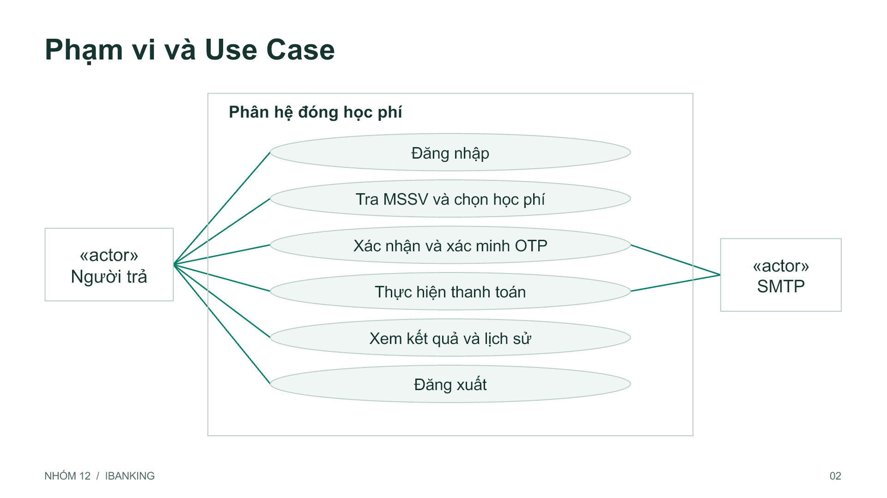
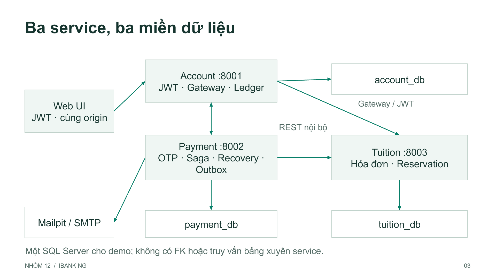
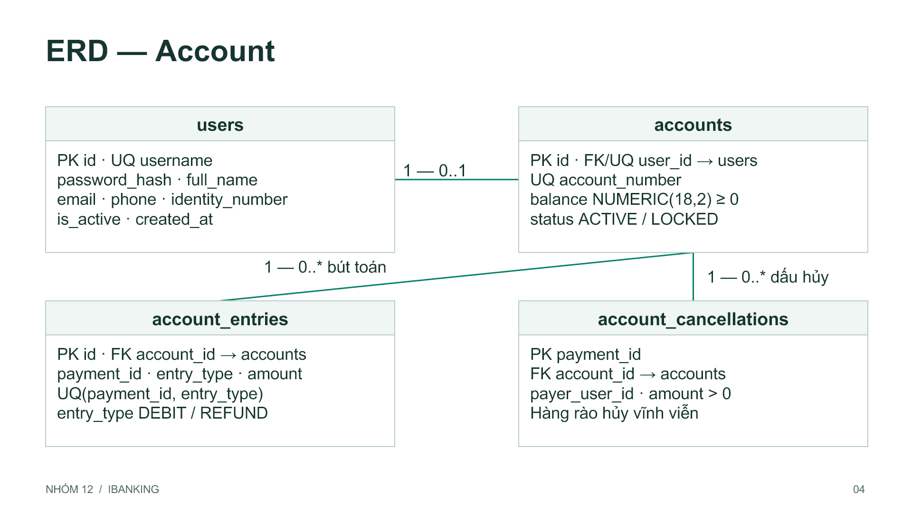
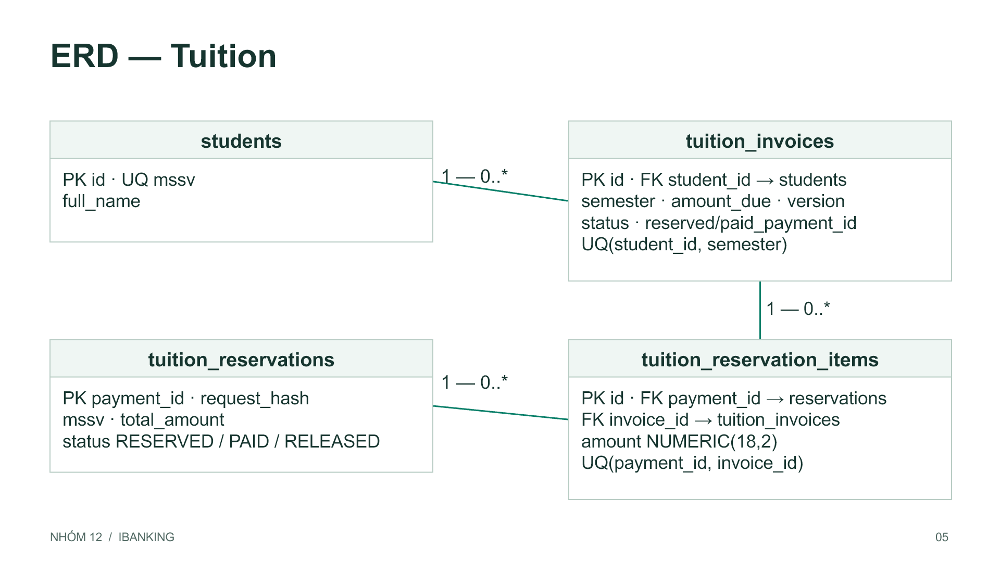
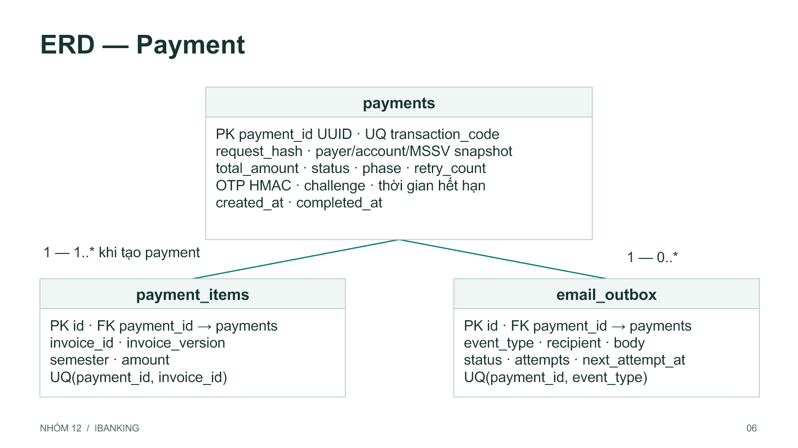
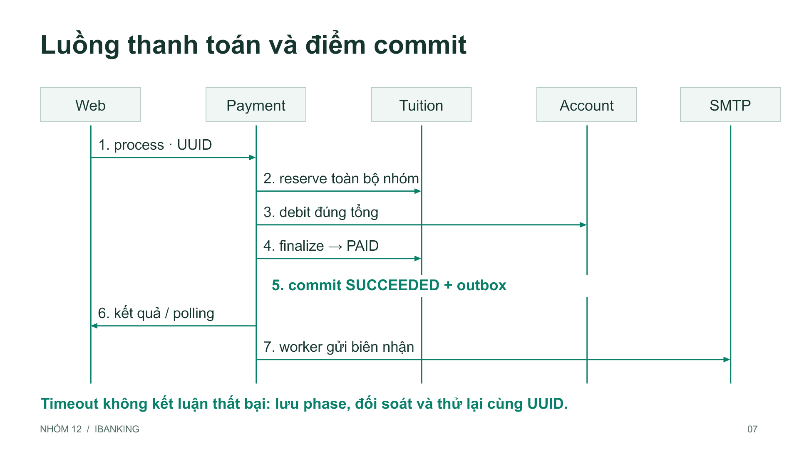

# PHÂN HỆ ĐÓNG HỌC PHÍ QUA IBANKING

BÁO CÁO DỰ ÁN GIỮA KỲ

Môn học: {{COURSE}}

{{GROUP}}

Giảng viên: {{LECTURER}}

| Thành viên | Họ và tên | MSSV |
|---|---|---|
| 1 | {{MEMBER1}} | {{ID1}} |
| 2 | {{MEMBER2}} | {{ID2}} |
| 3 | {{MEMBER3}} | {{ID3}} |

Ngày nghiệm thu: 02/11/2026. Hoàn thành sớm các mốc kế hoạch 02–08/11/2026.

Nền tảng: FastAPI, SQLAlchemy, SQL Server, HTML/CSS/JavaScript và Docker Compose.

Hai thành viên còn lại và phân công thực tế do nhóm bổ sung trước khi nộp.

---

## 1. Phạm vi và yêu cầu nghiệp vụ

Phân hệ cho phép chủ tài khoản đăng nhập, xem thông tin người trả, tra cứu học phí theo MSSV, chọn một hóa đơn/học kỳ, nhiều hóa đơn hoặc toàn bộ học phí chưa đóng. Người trả có thể thanh toán cho một sinh viên khác. Mỗi giao dịch phải xác minh OTP qua email, ghi nhận kết quả và gửi biên nhận sau khi thành công.



Điều kiện trước: người dùng active, tài khoản ACTIVE, JWT hợp lệ, MSSV tồn tại và có hóa đơn có thể thanh toán. Thông tin người trả chỉ đọc; server xác định người trả từ JWT. Client không được tự gửi payer_id, account_id hoặc amount.

Luồng chính: đăng nhập → tra MSSV → lựa chọn → chốt snapshot và tổng tiền → nhận/nhập OTP → xử lý → xem kết quả/lịch sử → nhận email. Khi chờ đối soát, người dùng tra cứu cùng UUID thay vì tạo giao dịch mới.

Luồng thay thế: đăng nhập sai; không tìm thấy MSSV; hóa đơn thay đổi; OTP sai/hết hạn; không đủ số dư; hóa đơn đang được giao dịch khác giữ; service hoặc email tạm thời không khả dụng. Mỗi nhánh có HTTP status và thông báo để UI xử lý.

Nguồn UML có thể sửa: docs/diagrams/use-cases.puml. Đăng xuất xóa token trên trình duyệt; chưa có cơ chế thu hồi JWT trung tâm.

---

## 2. Kiến trúc Microservices



| Service | Dữ liệu sở hữu và trách nhiệm |
|---|---|
| Account | User, JWT, tài khoản, số dư, ledger và hàng rào hủy debit; gateway public API cho Web |
| Tuition | Sinh viên, hóa đơn, version, reservation nhiều hóa đơn và hàng rào release |
| Payment | UUID, snapshot người trả/hóa đơn, OTP, trạng thái/phase, recovery và email outbox |

Payment giao tiếp với hai service còn lại bằng REST có X-Internal-Key; không import model hoặc đọc bảng của service khác. UI đi qua gateway cùng origin tại Account bằng JWT. Gateway chỉ cho phép các tuyến public và không chuyển internal key từ trình duyệt.

Mỗi service có database, engine, session và migration riêng. Bản demo đặt ba database trong cùng một SQL Server và chưa tách SQL login theo database. Hai worker đối soát và email chạy cùng Payment, vì vậy người dùng vẫn khởi động toàn bộ hệ thống bằng một lệnh.

Docker Compose điều phối SQL Server, db-init, ba service và Mailpit, dùng healthcheck và volume bền vững. Proxy gây lỗi chỉ có trong cấu hình acceptance riêng, không thuộc cấu hình demo mặc định.

---

## 3. Thiết kế dữ liệu — Account



users lưu mật khẩu đã băm, hồ sơ và cờ active. accounts có quan hệ tối đa một tài khoản với một user qua FK/UNIQUE(user_id); balance dùng NUMERIC(18,2), CHECK(balance >= 0), status chỉ ACTIVE hoặc LOCKED.

account_entries là ledger bất biến theo thao tác: DEBIT hoặc REFUND; UNIQUE(payment_id, entry_type) ngăn tạo cùng loại bút toán hai lần. amount luôn dương. Account lấy payer_user_id, account_id và tổng tiền đã xác nhận từ REST nội bộ; kiểm tra đúng chủ trước khi thay đổi số dư.

account_cancellations dùng payment_id làm PK để chặn debit đến muộn sau quyết định hủy. Nếu debit đã thành công, cancel hoàn đúng khoản đã trừ và giữ dấu hủy; nếu chưa có debit, cancel chỉ lưu hàng rào. Không xóa dấu hủy theo thời gian trong phiên bản này.

Mỗi debit/cancel/refund dùng transaction SQL Server cục bộ, khóa theo UUID và khóa dòng tài khoản. Kiểm tra trạng thái, số dư, cập nhật số dư và ghi ledger cùng commit. Các ID payment là tham chiếu logic; không có FK sang payment_db.

Sơ đồ liệt kê thuộc tính cốt lõi. Schema đầy đủ: services/account/models.py; phiên bản migration và dữ liệu cũ: docs/migrations.md.

---

## 4. Thiết kế dữ liệu — Tuition



students có MSSV duy nhất. tuition_invoices dùng UNIQUE(student_id, semester), mỗi học kỳ một hóa đơn; amount_due dương, version nguyên tăng khi thay đổi dữ liệu liên quan. Trạng thái hóa đơn: UNPAID → RESERVED → PAID; release đưa nhóm đang giữ về UNPAID.

tuition_reservations có PK payment_id, tổng tiền, MSSV, request_hash và trạng thái RESERVED/PAID/RELEASED. tuition_reservation_items tham chiếu reservation và invoice cùng database; UNIQUE(payment_id, invoice_id), lưu amount đã giữ. Snapshot version đã xác nhận nằm trong payment_items; reserve kiểm tra version hiện tại trước khi giữ hóa đơn.

reserve kiểm tra tất cả hóa đơn thuộc cùng MSSV, đúng phiên bản, đúng tổng và có thể giữ, sau đó cập nhật cả nhóm trong một transaction. Khóa hóa đơn theo thứ tự ID tăng dần để giảm deadlock. Nhóm [A,B] cạnh tranh với [B,C] không được commit một phần nhóm khi B không khả dụng.

finalize chuyển toàn bộ nhóm sang PAID cùng UUID. release trước reserve tạo tombstone RELEASED để chặn request đến muộn. Không tự nhả reservation đang xử lý tiền theo TTL khi kết quả còn chưa rõ; cần đối soát trước.

Sơ đồ lược các cột thời gian. Schema đầy đủ: services/tuition/models.py.

---

## 5. Thiết kế dữ liệu — Payment



payments dùng UUID làm PK và transaction_code duy nhất. Bản ghi lưu request_hash, người trả/email/tài khoản, MSSV/tên sinh viên, selection_mode, total_amount, status, phase, retry_count và thời điểm xử lý. Đây là snapshot dùng cho xác nhận, email và đối soát.

payment_items có FK cùng DB tới payments, UNIQUE(payment_id, invoice_id), lưu invoice_id, invoice_version, semester và amount. Một giao dịch có 1–100 hóa đơn. ALL_UNPAID lấy đúng các hóa đơn UNPAID tại thời điểm tạo; không tự thêm hóa đơn phát sinh sau khi người dùng xác nhận.

email_outbox có FK đến payments và UNIQUE(payment_id, event_type), lưu người nhận, nội dung, trạng thái, số lần thử và lịch retry. Khi thành công, cập nhật SUCCEEDED và thêm sự kiện PAYMENT_SUCCEEDED trong cùng transaction Payment.

Không có FK xuyên database cho payer_user_id, account_id hoặc invoice_id. Mỗi DB có bảng schema_revisions riêng để theo dõi migration; bảng hạ tầng này được lược khỏi ERD nghiệp vụ. Migration có phiên bản, chạy lặp không reset số dư hoặc hóa đơn đã thanh toán.

Schema đầy đủ và các trường OTP: services/payment/models/payment.py. API trả tiền bằng chuỗi thập phân, thời gian UTC ISO 8601.

---

## 6. REST API công khai

JWT dùng Authorization: Bearer token. Idempotency-Key là UUID do client tạo và giữ lại khi retry. Mọi endpoint payment kiểm tra đúng chủ; không tìm thấy hoặc sai chủ cùng trả 404.

| Method và URI | Request | Response / HTTP status |
|---|---|---|
| POST /auth/login | username, password | 200 JWT; 401/403/422 |
| GET /users/me | JWT | 200 hồ sơ; 401/403 |
| GET /accounts/me | JWT | 200 tài khoản/số dư; 401/403/404 |
| GET /api/v1/tuition/{mssv} | JWT, MSSV | 200 sinh viên/hóa đơn; 401/404/422 |
| POST /api/v1/payments | JWT, UUID, lựa chọn | 201 mới; 200 lặp; 409/422/503 |
| GET /api/v1/payments | limit, cursor | 200 items/next_cursor; 401/404/422 |
| GET /api/v1/payments/{id} | JWT, UUID | 200 PaymentView; 401/404/422 |
| POST .../{id}/send-otp | JWT | 202 metadata; 409/429/503 |
| POST .../{id}/verify-otp | challenge_id, otp | 200 OTP_VERIFIED; 400/409/429 |
| POST .../{id}/process | JWT | 200 SUCCEEDED; 202 chờ; 409/503 |

Trong ba hàng cuối, prefix là /api/v1/payments. Danh mục đầy đủ gồm tất cả status, auth, body, ví dụ request/response và gateway nằm trong docs/api.md. Swagger và OpenAPI được xuất từ từng service tại /docs và /openapi.json.

Ví dụ tạo một hóa đơn:

```json
{"mssv":"SV2026001","selection_mode":"SELECTED","invoice_ids":[1]}
```

Ví dụ tạo toàn bộ công nợ:

```json
{"mssv":"SV2026001","selection_mode":"ALL_UNPAID"}
```

Response PaymentView chứa payment_id, transaction_code, người trả, MSSV, items, total_amount, status, phase, thời gian và receipt_status. OTP không xuất hiện trong response. Cùng UUID khác payload trả 409, cùng payload trả snapshot cũ.

---

## 7. REST API nội bộ và phối hợp service

Tất cả tuyến /internal yêu cầu X-Internal-Key. Cổng riêng: Account 8001, Payment 8002, Tuition 8003. Tên host Docker dùng service name, không dùng localhost giữa container.

| Service / Method / URI | Input | Output chính |
|---|---|---|
| Account POST /internal/accounts/debit | UUID, account, payer, amount | Operation DEBITED; 409 thiếu tiền/sai dữ liệu |
| Account POST /internal/accounts/cancel | Cùng DebitRequest | CANCELLED hoặc REFUNDED |
| Account POST /internal/accounts/refund | payment_id | REFUNDED; 404 nếu chưa debit |
| Account GET /internal/account-operations/{id} | UUID | Operation; 404 chưa có |
| Tuition GET /internal/tuition/invoices | mssv | Sinh viên và danh sách hóa đơn |
| Tuition POST /internal/tuition/reservations | UUID, mssv, items/version, expected_total | ReservationView; 409 nếu xung đột |
| Tuition GET .../reservations/{id} | UUID | RESERVED/PAID/RELEASED hoặc 404 |
| Tuition POST .../reservations/{id}/finalize | UUID | PAID cả nhóm |
| Tuition POST .../reservations/{id}/release | UUID | RELEASED cả nhóm hoặc tombstone |

Operation chứa payment_id, account_id, amount, status. ReservationView chứa payment_id, status, mssv, total_amount, invoice_ids. Payment xác minh UUID, tập hóa đơn, tài khoản và tổng trả về khớp snapshot trước khi chấp nhận kết quả.

Mỗi service có GET /health và /health/db, trả 503 khi DB chưa khả dụng. Lỗi validation là 422, thiếu/sai thông tin xác thực 401, xung đột nghiệp vụ 409; timeout hoặc lỗi dependency được Payment lưu để đối soát khi thao tác có thể đã có hiệu lực.

Chi tiết schema JSON, status theo từng endpoint và ví dụ request đầy đủ: docs/api.md. Không đưa internal key hoặc tài khoản SQL/SMTP vào UI, ảnh minh họa hoặc bản nộp.

---

## 8. Transaction và phục hồi giao dịch



Trạng thái chính: PENDING_OTP → OTP_VERIFIED → PROCESSING → SUCCEEDED. Khi chưa biết kết quả, chuyển PENDING_RECONCILIATION; worker xử lý lại theo phase RESERVE/DEBIT/FINALIZE/CANCEL. Kết quả thất bại cuối là FAILED hoặc REFUNDED tùy đã trừ tiền hay chưa.

Không dùng một transaction SQL bao trùm ba service. Mỗi service commit cục bộ; Payment điều phối saga bền vững. Không giữ transaction DB mở trong lúc gọi HTTP/SMTP. Mất phản hồi sau commit khác với thao tác chưa chạy: retry cùng UUID trả lại hiệu lực cũ, không trừ hoặc finalize lần hai.

Nếu phải hủy, Payment chặn finalize bằng release tại Tuition trước, rồi cancel/refund tại Account. Khi Tuition đã PAID, không hoàn tiền theo suy đoán. Tombstone tại Tuition và Account chặn request cũ đến muộn.

Session applock theo UUID ngăn hai request/worker cùng điều phối. Kiểm thử tải phát hiện guard chiếm hết pool ORM; bản sửa dùng engine NullPool riêng cho guard, nhờ đó transaction dữ liệu ngắn có kết nối để hoàn tất.

---

## 9. OTP, email và bảo vệ truy cập

OTP sáu chữ số được gửi tới email snapshot của người trả. HMAC gắn mã với payment UUID, challenge, danh sách/phiên bản hóa đơn và tổng tiền. DB không lưu OTP rõ; log/API không trả mã. Hạn 5 phút, tối đa 5 lần sai và tối thiểu 60 giây giữa hai lần gửi.

Xác minh đúng tiêu thụ OTP. Gửi lại vô hiệu mã và xác minh cũ. process phải bắt đầu trước khi xác minh hết hạn; giao dịch đã bắt đầu tiếp tục được recovery dù OTP hết hạn sau đó. SMTP lỗi lúc gửi OTP hủy challenge vừa cấp và cho phép thử gửi lại. Metadata active_challenge giúp tải lại trang mà không cần tạo payment khác.

Biên nhận được ghi vào outbox cùng transaction SUCCEEDED. Worker gửi độc lập, retry có backoff tối đa 300 giây. SMTP lỗi không đổi kết quả payment và không gọi debit/finalize lại. Có thể có email trùng khi SMTP nhận thư nhưng mất ACK; một outbox event và Message-ID cố định hỗ trợ đối chiếu, không bảo đảm SMTP gửi đúng một lần.

JWT kiểm tra chữ ký, issuer, audience, subject và hạn dùng. API lấy người trả từ JWT, kiểm tra ownership với UUID; client không sửa được số tiền. Token/OTP chỉ giữ trong RAM trình duyệt; sessionStorage chỉ giữ UUID và user ID để khôi phục luồng. Internal key và SQL/SMTP password chỉ nằm trong cấu hình riêng, không xuất vào source backup.

Docker mặc định dùng Mailpit để demo, không cần tài khoản mail thật. Muốn nhận thư bên ngoài, điền SMTP_HOST, SMTP_PORT, SMTP_FROM, SMTP_USERNAME, SMTP_PASSWORD và chế độ SSL/STARTTLS vào infra/env/docker.env, sau đó chạy lại start.ps1. Thông số cụ thể phải lấy từ nhà cung cấp; hướng dẫn có trong docs/runbook.md.

Giới hạn hiện tại: chưa có thu hồi JWT tập trung, chống brute-force đăng nhập theo IP hoặc quản trị người dùng; HTTPS và SQL login tối thiểu quyền cần bổ sung trước khi triển khai thực tế.

---

## 10. Giao diện và trải nghiệm sử dụng


Giao diện có đăng nhập, hồ sơ người trả chỉ đọc, tra MSSV, danh sách học kỳ và trạng thái, chọn một/nhiều/toàn bộ, tổng tiền, xác nhận snapshot, nhập OTP, kết quả và lịch sử phân trang. Desktop và mobile dùng chung API qua Account gateway.

Lúc đang xử lý hoặc mất phản hồi, UI giữ UUID và hướng dẫn tra kết quả giao dịch đó. Retry tạo/process dùng cùng mã; không tạo thanh toán mới chỉ vì timeout. Tải lại trang và đăng nhập lại có thể tiếp tục giao dịch đang chờ OTP bằng metadata đã lưu ở server.

Lịch sử chỉ hiển thị giao dịch của chủ JWT. Trạng thái đang đối soát, hoàn tiền, thành công và biên nhận đang gửi được trình bày riêng. Ảnh sử dụng dữ liệu kiểm thử hư cấu; không chứa OTP hoặc cấu hình bí mật.

Bộ Playwright kiểm tra desktop/mobile, quy trình OTP thật qua Mailpit, giữ UUID khi phản hồi bị mất và phục hồi luồng sau reload. Bằng chứng: artifacts/browser-acceptance.json và ảnh trong artifacts/.

---

## 11. Kết quả kiểm thử và nghiệm thu

| Nhóm kiểm thử | Kết quả |
|---|---|
| Unit / startup / validation | 29 passed; 1 cảnh báo deprecation từ thư viện test |
| Backend SQL Server / SMTP | 8 kịch bản đạt, gồm cạnh tranh số dư/hóa đơn, OTP, retry, email |
| Edge Playwright | 4 bài desktop/mobile đạt |
| Release acceptance tách biệt | 7 kịch bản đạt; project {{PROJECT}} |

Thử tải: {{PAYMENTS}} giao dịch trên 8 tài khoản, {{WORKERS}} request process đồng thời, {{INVOICES}} hóa đơn. Tất cả response lần đầu là 200. p50 {{P50}} giây, p95 {{P95}} giây, lâu nhất {{MAX}} giây; thời gian hoàn tất/đối chiếu {{CONVERGENCE}} giây. Mỗi UUID có đúng một DEBIT, hai hóa đơn PAID đúng UUID, tổng 1.000.000 đồng và một outbox event. Đây là phép đo trên máy Docker hiện tại, không phải SLA production.

| Tình huống lỗi thực tế | Bằng chứng kết quả |
|---|---|
| Mất reply sau Account commit | Retry/đối soát SUCCEEDED; một DEBIT |
| Mất reply sau Tuition finalize | PAID được giữ; Payment về SUCCEEDED |
| Docker network disconnect/connect | Chờ đối soát, kết nối lại và hoàn tất |
| SIGKILL Payment sau debit | Restart worker, không trừ lần hai |
| SIGKILL SQL giữa transaction | Bút toán chưa commit bị rollback; retry thành công |
| Môi trường mới | Volume mới, seed mới; trả một kỳ và toàn bộ còn lại qua SMTP |

Lần thử tải ban đầu bị hết thời gian chờ do guard chung pool ORM; dữ liệu sau đối soát vẫn đúng. Sau sửa, toàn bộ bài tải và fault đạt. Log lần thất bại được giữ để truy vết, không bị thay bằng số liệu đạt.

Nguồn máy đọc được: artifacts/release/{{RUN}}/acceptance.json; bản tổng hợp artifacts/release-acceptance-latest.json. Bản cuối dựng image không dùng cache, dùng volume và dữ liệu hoàn toàn mới. Các container acceptance đã dừng; volume riêng được giữ để đối chiếu. Demo chính không dùng các volume này.

---

## 12. Cài đặt, diễn tập và bản dự phòng

Cài Docker Desktop, bật Linux containers và chạy PowerShell trong thư mục gốc dự án. Lần đầu cần mạng để tải image và package; chạy ứng dụng bằng Docker không cần Python/Node trên máy host.

```powershell
.\start.ps1
```

Script tạo cấu hình riêng nếu thiếu, khởi động Docker Desktop, build image, đợi DB/seed/healthcheck và chạy toàn bộ service. Log ở một terminal; Ctrl+C dừng. Chạy nền: .\start.ps1 -Detached. Kiểm tra môi trường: .\start.ps1 -Check. Không dùng down -v khi cần giữ dữ liệu.

| Mục | Giá trị demo |
|---|---|
| Giao diện | http://127.0.0.1:8001/ui/ |
| Hộp thư Mailpit | http://127.0.0.1:8025 |
| Tài khoản mẫu | huy / HuyDemo_123! |
| MSSV mẫu | SV2026001 |
| Ban đầu trên volume mới | Số dư 10 triệu; HK1 2 triệu, HK2 3 triệu |

Demo 5–10 phút: giới thiệu ba service → đăng nhập → tra MSSV → chọn một kỳ → lấy OTP Mailpit → process → đối chiếu số dư/PAID/lịch sử/email → trả tất cả công nợ còn lại → trình bày các bài cạnh tranh và phục hồi. Dữ liệu thanh toán được giữ qua restart; không hứa demo lại từ 10 triệu nếu đã dùng cùng volume.

Bản dự phòng gồm source ZIP, báo cáo PDF, slide PPTX có thể sửa, sơ đồ PNG, các tài liệu Markdown/API và bằng chứng JSON/ảnh đã chọn. ZIP loại cấu hình riêng, .git, .venv, node_modules, dữ liệu SQL và log thô. Tệp SHA256SUMS.txt giúp kiểm tra file khi sao chép.

Kịch bản chi tiết, phương án khi máy/mạng lỗi và checklist trước nộp nằm ở docs/demo-script.md và docs/submission-checklist.md. Không giả lập thành công khi hệ thống đang đối soát; dùng UUID và bằng chứng đã lưu để trình bày đúng tình trạng.

---

## 13. Đối chiếu đề bài và hướng phát triển

| Yêu cầu | Hồ sơ/mã nguồn chứng minh |
|---|---|
| 1. Phân tích nghiệp vụ, Use Case, ERD | Chương 1, 3–5; docs/architecture.md; sơ đồ PNG/UML |
| 2. Kiến trúc Microservices | Chương 2; compose.yaml; ba thư mục services |
| 3. Thiết kế REST API | Chương 6–7; docs/api.md; OpenAPI ba service |
| 4. Thiết kế/hiện thực CSDL | Chương 3–5; models, migrations; docs/migrations.md |
| 5. Lập trình service và API | services/account, payment, tuition; backend acceptance |
| 6. Transaction/concurrency | Chương 8, 11; locking, ledger, reservation, saga; audit ba DB |
| 7. Web tích hợp API | Chương 10; frontend; gateway; Edge E2E |
| 8. Tài liệu và trình diễn | Chương 12; runbook, demo script, báo cáo, PPTX, ZIP |

Phân hệ đáp ứng phạm vi bài giữa kỳ và đã có kiểm thử trên SQL Server thực. Các mục nâng cấp: SQL login riêng theo DB, TLS/cấu hình secret cho môi trường triển khai, rate limit đăng nhập, thu hồi JWT, quan sát tập trung, cảnh báo đối soát kéo dài và thử tải dài hạn trên máy chủ mục tiêu. Chưa có dashboard quản trị hoặc triển khai cloud trong phạm vi một tuần.

Tài liệu kỹ thuật tham khảo:

- Microsoft Learn, sp_getapplock: https://learn.microsoft.com/en-us/sql/relational-databases/system-stored-procedures/sp-getapplock-transact-sql
- Microsoft Learn, table hints/UPDLOCK: https://learn.microsoft.com/en-us/sql/t-sql/queries/hints-transact-sql-table
- SQLAlchemy, connection pooling/NullPool: https://docs.sqlalchemy.org/en/20/core/pooling.html
- Python, smtplib: https://docs.python.org/3/library/smtplib.html
- RFC 5321, SMTP và retry sau timeout: https://www.rfc-editor.org/rfc/rfc5321
- Docker Compose, startup order: https://docs.docker.com/compose/how-tos/startup-order/

Nguồn nội bộ: docs/api.md, architecture.md, migrations.md, runbook.md; tests/unit, tests/integration, tests/e2e và các JSON nghiệm thu. Các tài liệu kiến trúc/kiểm thử là mô tả sản phẩm đã chạy; phân công thành viên cần nhóm xác nhận theo công việc thực tế.
